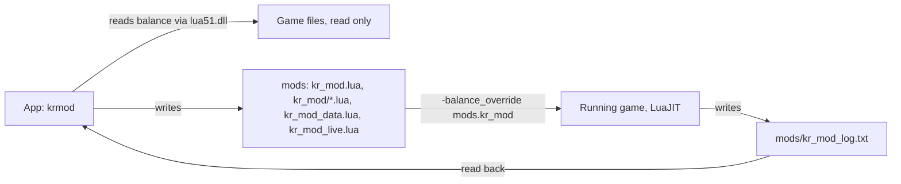

# AGENTS.md

Guide for coding agents (Claude Code, Codex and similar) working on KrGenesis Mod. User-facing documentation is in README.md.

## What this is

A Windows desktop app (Python, NiceGUI in a WebView2 window) that edits Kingdom Rush 6: Genesis (v1.01.008) and writes a Lua mod into `<game folder>\mods`. The game loads that mod through its own `-balance_override mods.kr_mod` option, started by `mods\launch_modded.bat` or the app's Apply mod and run game button.



## Hard rules

- Never modify game files. The only folder the app (and you) may write in the game folder is `mods`.
- Never commit game files, extracted art, game bytecode or decompiled game code. If you decompile game files to research something, keep the output in a scratch folder outside the repo, delete it afterwards, and do not paste game code into commits, PRs or docs.
- The app never writes to `%APPDATA%` or `%LOCALAPPDATA%`. Profiles, settings.json, cache (portraits, app.log, WebView2 storage) and the exe's runtime folder all live next to the app (repo root from source, the exe's folder when frozen). Keep it that way.
- Mod features never write the player's save. The game saves normal purchases itself; say so in the UI text when a feature leads to that.
- Never kill processes by image name (`taskkill /IM`): the owner may be running the app or the game. Close or kill by PID or by full path.
- Prose style: no em-dashes.

## Setup and commands

The repo is expected to sit inside the game folder (`<game folder>\kingdomrush-data-mod`). Tests and the app find the game there, or through the `KRMOD_GAME_DIR` environment variable. Without a game folder, game-dependent tests are skipped.

```bat
py -3.12-64 -m venv .venv
.venv\Scripts\python.exe -m pip install -e .[dev]

rem run the app from source
.venv\Scripts\python.exe -m krmod

rem all tests (about 410, 1-2 minutes); one file: add tests\test_profiles.py
.venv\Scripts\python.exe -m pytest -q

rem build dist\KrGenesisMod.exe (single file, PyInstaller)
scripts\build.bat
```

- Python must be 64-bit: `krmod/gamedata/luart.py` loads the game's 64-bit `lua51.dll` (LuaJIT) with ctypes.
- When a tool captures pytest output unreliably, redirect it to a file and read the file.
- The build overwrites `dist\KrGenesisMod.exe`; it fails if that exe is running. `dist\` also holds the owner's profiles: never delete it.

## Layout

| Path | Responsibility |
|---|---|
| `krmod/app.py`, `__main__.py` | Entry point: storage paths, WebView2 flags, window setup, `ui.run` |
| `krmod/paths.py` | Game folder discovery (env var, settings.json, parent folder), app folder, settings.json |
| `krmod/gamedata/` | `luart.py` runs Lua in the game's lua51.dll; `reader.py` reads the original balance table from the game exe's embedded files |
| `krmod/model/` | Balance tree types, grouping into tabs and cards, rows, percent scaling, number box stepping and clamping |
| `krmod/profiles.py` | Profile dataclass, JSON format, validation, `RULE_DEFAULTS` and `rules_dict` for Progression rules |
| `krmod/state.py` | `AppState`: the one place the UI changes values, rules and live settings |
| `krmod/modgen/` | `writer.py` writes the mod files atomically, `launcher.py` starts the game, `logwatch.py` parses kr_mod_log.txt |
| `krmod/ui/` | NiceGUI views; `spinbox.js`/`spinbox.py` is the single custom number box used everywhere |
| `mod_template/` | Lua copied verbatim into `<game>\mods`: `kr_mod.lua` (loader), `kr_mod/*.lua` modules |
| `tests/` | pytest; `lua_harness.py` runs the Lua mod against stubbed game globals in the real lua51.dll; `ui_main.py` + NiceGUI `user` fixture for UI tests |

## How the Lua mod works

- `kr_mod.lua` runs every time the game rebuilds its balance table: when the map screen opens and at every level start. Each step runs under `pcall`; problems go to `mods/kr_mod_log.txt`, never into the game.
- `kr_mod_data.lua` (written on Apply mod) holds balance changes, rules and speed keys. `kr_mod_live.lua` holds speed, enemy multiplier and troop delta; the game polls it about once a second, so live controls apply mid-level.
- State that must survive reruns lives in the global `KRMOD` table (`K`). Hooks on game functions are installed once and reinstalled only when the game replaced the function (see `wrap_once` in `kr_mod/progress.lua`). Read rule values at call time from `K.data.rules`, so toggling a rule needs no reinstall.
- Point tables are restored from a copy of the game's own values before extras are added, so reruns never stack.
- The app reads `kr_mod_log.txt` back after Apply mod: keep its line prefixes (`applied`, `missing`, `unlock`, `error`) stable or update `modgen/logwatch.py` and its tests.

## Adding a Progression rule (pattern)

1. Add the key and default to `RULE_DEFAULTS` and a field to `Profile` in `profiles.py` (validation, JSON and kr_mod_data.lua follow automatically). Older profiles load with the default.
2. UI: a switch or `PointsBox` in `krmod/ui/rules.py`, saving through `state.set_rule(name, value)`.
3. Lua: read `data.rules.<key>` in the loader or a `kr_mod/` module; log one line when active.
4. Tests: a Lua harness test for the in-game behaviour (on, off, reruns), plus the profile, writer and Rules tab tests that list the rules.
5. README: describe the feature in user terms, including whether anything ends up in the save.

## Verifying changes

- Run the full test suite before every commit.
- For Lua or in-game behaviour, also check the real game when possible: apply, start the game, wait until the map screen has loaded (the log is rewritten then), read `mods\kr_mod_log.txt`, and look at the affected screen. Ask before closing a game the owner is using.
- UI changes: check the actual window or the page served by NiceGUI, not only the user-simulation tests.

## Git and PRs

- Branch from the latest `origin/main` (`git fetch origin` then `git checkout -b <type>/<topic> origin/main`, for example `feat/...`, `fix/...`, `docs/...`), then `git branch --unset-upstream` so a plain push cannot target main. Never commit to main directly.
- One PR per change, merged with a merge commit; delete the branch afterwards.
- Commit messages and PR descriptions: plain sentences, no AI attribution or Co-Authored-By trailers. PR descriptions state what changed, how it works in the game, and how it was tested.
