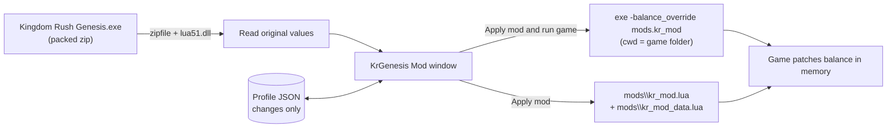

# KrGenesis Mod: design

Date: 2026-11-01
Status: approved by the owner

## 1. Intent

The owner plays Kingdom Rush 6: Genesis (v1.01.008, Windows, local install at C:\Games\KR6.Genesis.TD.v1.01.008_LinkNeverDie.Com) and wants to change the game's numbers: towers, troops, heroes, skills, enemies, items and stage values. Today that means decompiling bytecode and hand-editing Lua. The owner wants a visual desktop app instead: pick a unit from picture cards, see its numbers per level, change them by typing or with sliders, then press Apply mod, or Apply mod and run game.

They also want rule switches. The first one is "unlock all tower levels" on every stage and mode, because stage 1 (the tutorial) blocks upgrading towers past level 1.

## 2. Goals

- Show every number from the game's stat file (kr6/data/balance/balance.lua, 5,857 numeric values) in a visual app. All are editable except enum codes such as damage_type, which are shown read-only (8.4).
- Group them into tabs: Towers, Troops, Heroes, Skills, Enemies, Items, Stages, Rules.
- Layout C ("hybrid"), chosen by the owner from mockups:
  - left: picture cards to pick a unit
  - right: a table with one column per level
  - Rules tab for switches
- Both slider styles, chosen by the owner:
  - C1: per-unit "scale all X" sliders (for example All costs, All damage, All range, 50% to 300%, middle mark = original), plus a per-row slider that scales every level of one stat together.
  - C2: clicking a row opens a panel with one slider per level, grey (original) vs blue (modded) bars, and a lock that moves all levels together.
- Typing an exact value works everywhere.
- Apply mod writes the mod into the mods folder. Apply mod and run game also launches the game with the mod active.
- Rules tab, first switch: unlock all tower levels on all stages and modes, Heroic included.
- Game speed ×1 / ×2 / ×3, changed live in the middle of a level (owner's request; it's why the mod must be live). It's controlled from both places, owner's choice:
  - in game: one key per speed, F5 = ×1, F6 = ×2, F7 = ×3 (owner confirmed), remappable in the app
  - in the app: ×1 / ×2 / ×3 buttons
- Enemy count multiplier: one global slider in the app (owner's request) that raises or lowers how many enemies spawn, changed live like speed. It's one number for every stage, not a value per stage or per wave. Every reward from killing enemies scales linearly with the multiplier, with no compensation (owner's choice): 3× enemies means 3× gold and 3× gems.
- Troop count, owner wants both:
  - per tower: base counts (for example towers.knights.max_soldiers = 3) are ordinary stat values in the editor, applied from the next level start
  - live: one global troop multiplier slider in the app, applied mid-level to every tower that fields units, including towers already on the map
- Stat and unlock changes apply live from the next level start, with no game restart.
- The app is an independent desktop window, not a browser tab.

## 3. Non-goals

- Changing game behavior or logic (what skills do, AI, new units). Numbers only.
- Editing wave files (kr6/data/waves/*.tsv: starting gold, lives, enemy counts). Possible later; out of scope now.
- Editing art, audio, text or animations.
- Any online, multiplayer or account-related features.
- Supporting other Kingdom Rush titles.
- Per-stage or per-wave enemy counts. The enemy multiplier is one global number.
- Enemy multiplier on stage 3 Heroic (its waves exist only in the Lua format, see 6.7) and in Endless mode. Both play with normal counts.

## 4. Anti-goals (failure even if it "works")

- Modifying the game executable or any original game file. The 1.1 GB exe with its packed data must stay byte-identical. Launching the game normally must always give the unmodded game.
- Values silently missing. Every numeric value in balance.lua must be reachable in some tab. Anything the grouping rules cannot place goes to a visible "Other" group in the nearest tab, never dropped.
- Losing track of the original numbers. Every changed value must show its original and be resettable one by one.
- Publishing game content. The GitHub repo must never contain game files, extracted bytecode, decompiled game code or extracted art.
- Files written outside the game folder, other than what Python, packaging and git need on their own.

## 5. Constraints

- Platform: Windows 10/11 x64. The owner has Python 3.12 (pyenv). Microsoft Edge WebView2 is installed. Python and the packaged app must be 64-bit, because the game's lua51.dll is x64.
- Folder rule from the owner: everything new goes in new folders inside the game folder.
  - kingdomrush-data-mod\ holds the app source, docs and the packaged app (folder named after the GitHub repo).
  - mods\ holds the generated mod that the game loads.
- Language and UI: Python with NiceGUI in native mode (its own window through pywebview and WebView2). The owner picked this.
- Version control: kingdomrush-data-mod is a git repo pushed to the owner's private GitHub repo ttuyetdinh/kingdomrush-data-mod. It follows the owner's git workflow: feature branches from origin/main, no AI attribution in commits.

## 6. How the game works (verified in this session)

These facts came from reverse engineering the install. They are the foundation for the design.

### 6.1 Packaging

- Kingdom Rush Genesis.exe is a fused LÖVE (Love2D) executable. The game data is a zip archive appended to the exe. Python's zipfile opens the exe directly: 4,736 entries.
- All game code is LuaJIT 2.1 bytecode (GC64 / FR2 flavor, header 1B 4C 4A 02 08) with debug info (chunk names like @./kr6/data/balance/balance.lua).
- Runtime DLLs sit beside the exe: love.dll, lua51.dll (LuaJIT 2.1), SDL2, OpenAL32, mpg123. The folder also contains a Steam emulator and loader (winmm.dll proxy, LinkNeverDie64.dll, steam_api.dll). The mod does not interact with those.
- The game's save identity is com.ironhidegames.kingdomrush.genesis.windows.steam (from version.lua).

### 6.2 Reading the stat file outside the game (verified)

- Load the game's own lua51.dll from Python with ctypes (luaL_newstate, luaL_openlibs, luaL_loadbuffer, lua_pcall, plus the table-walking API or a small Lua walker script). Bytecode contains NUL bytes, so it must be loaded with luaL_loadbuffer (explicit length), never luaL_loadstring. The verified probe read the files through Lua's own loadstring, which takes an explicit length.
- Run all/constants.lua (defines globals like FPS = 30 and DAMAGE_PHYSICAL = 2), then run kr6/data/balance/balance.lua. Both are read from the zip inside the exe.
- Result: one nested table with 5,857 numbers, 1,665 sub-tables, 34 strings and 7 booleans. For example towers.archers.price[1] = 70.
- No decompiler is needed. This keeps working after a game update as long as the file layout is unchanged.
- Top-level sections and value counts (from the decompiled copy, approximate):

| Section | Values | Contents |
|---|---|---|
| heroes | 1,337 | 12 heroes plus common: stats per level, basic attacks, skill_a/b/c, ultimate, talents, summons |
| enemies | 1,056 | 8 factions plus jt_boss and lord_blackburn_boss |
| towers | 1,001 | 15 towers plus common and upgrades; each has price per level, attacks, skill_a/b/c, ultimate, soldier(s) |
| specials | 677 | per-stage gimmicks, terrains, neutral and stage towers |
| kr1_mode | 363 | classic-mode towers and upgrades |
| powers | 235 | spells (reinforcements, rain_of_fire, etc.) |
| upgrades | 227 | spell upgrade tree |
| items | 8 | bomb, gold, hearts |

### 6.3 How the game consumes the stats

- kr6/templates_game.lua runs local balance = require("data.balance.balance") (decompiled line 21). It then copies values into unit templates, for example tt.tower.price = b.price[1].
- Templates reload at every level start (verified in code). sys.level:init (all/systems.lua) calls E:load(), and E:load (all/entity_db.lua) clears every module listed in __CHAINED_TEMPLATES from package.loaded and calls require("templates_game") again. templates_game adds itself to that list. So the -balance_override hook, and the mod, run again each time a level starts. data.balance.balance itself is never cleared, so the stat table keeps the previous run's patches unless the loader restores them.
- Some fields are enum codes, not stats. damage_type and similar *_damage_type fields hold DAMAGE_PHYSICAL, DAMAGE_MAGICAL, DAMAGE_TRUE, DAMAGE_EXPLOSION, DAMAGE_INSTAKILL or DAMAGE_EAT. Editing them would change behavior.
- Some values are derived at file load (for example melee_attack_range = mixed_attack_range * 1.2, cooldowns written as fts(15) = 0.5). The app sees and edits the final evaluated numbers. Changing a base value does not update values derived from it.
- Some paths may point to the same Lua table (aliasing through assignments like x = b.other.table). Editing through one path then changes the other.
- Each hero has a small stats block (heroes.<hero>.stats.hp = 6.5, armor, damage, cooldown; 48 values). These look like the 1-10 bars on the hero screen, not combat values (unverified). The Heroes tab labels them "Hero screen bars" so they aren't mistaken for real HP or damage.
- Other modules also require the stat table: kr6/upgrades.lua, kr6/data/modes.lua, kr6/data/levels/level11.lua, kr6/kviews_screen_map_game.lua (map, tower and hero rooms) and sequels/game_gui.lua. Modules that hold the same table object see the in-place patch. Menus on the map screen may show original numbers until a level has loaded once in that session (unverified, see 12).

### 6.4 The mod hook (verified in game)

templates_game.lua contains a developer switch. After clearing the cached balance module, it checks the command line for -balance_override. If present, it takes the next argument as a module name, clears that module from package.loaded and requires it. (Game code is not reproduced here; see the repo rule on decompiled code.)

- Launching the exe with "-balance_override mods.kr_mod" and the working directory set to the game folder makes LuaJIT's standard loader find mods\kr_mod.lua. That works because LuaJIT's package.path starts with .\?.lua. Verified: the in-game package.path was .\?.lua;C:\Games\...\lua\?.lua;...
- The game discards the module's return value, and templates_game already holds the stat table in a local named balance. The mod therefore walks the call stack with debug.getlocal, finds the local named balance (a table with a towers field), patches it in place, then sets package.loaded["data.balance.balance"] to the patched table so later requirers see the same values.
- Verified in game: level 1 Archer and Knights towers cost 7 instead of 70. Proof files confirmed the mod loaded and found the table in @./kr6/templates_game.lua.
- Dead ends, so the builder doesn't retry them:
  - Putting files in the game folder (for example kr6\data\balance\balance.lua) does not shadow the packed data. main.lua mounts the base directory only when the packed data is missing, and with appendToPath = true.
  - Putting files in the save directory (%APPDATA%\com.ironhidegames...) would shadow the packed data, but it breaks the owner's folder rule.

### 6.5 Tower level locks (implemented in the spike, not yet verified in game)

- Each stage's kr6/data/levels/levelNN_data.lua has a locked_towers list, at the top level and per mode in level_mode_overrides. The mode list replaces the base list for that mode (LU.load_data in all/level_utils.lua).
- Level locks are entries ending in _lvlN:
  - stage 1 campaign: level 2 of all 15 towers
  - stage 1 KR1 mode: level 2 of the 4 classic towers
  - stages 14, 15, 16, 17 and 19, mode index 2 (assumed Heroic): level 4 of 19 towers
  - other stages: none
- Tower-type entries (tower_build_*) are Iron-mode restrictions and must stay.
- The game checks store.level.locked_towers at use time: sequels/game_gui.lua (upgrade menu) and kr6/scripts_game.lua (mod_buy_available).
- The level loads before templates (and therefore before the mod), so the spike strips the list in place on game.store.level (and .data). It also wraps LU.load_data for levels loaded later.

### 6.6 Game speed (verified in code, not yet tried in game)

- all/game.lua, game:update(dt) runs every frame and checks self.DBG_TIME_MULT with no DEBUG gate (decompiled lines 407-419). For a whole number N ≥ 1 it calls self.simulation:update(dt) N times per frame, so the battle runs N times faster. For values below 1 it scales dt (slow motion). With nil it runs once.
- game is a global singleton (game.lua uses game.store), and it outlives levels, so a value set once persists until changed.
- The developer keys z and Z (game.lua 866-869) double or halve it, but only behind the DEBUG key switch. The mod doesn't rely on them.
- simulation:update returns early while the game is paused, so pause still works at any speed. Only the battle simulation speeds up. The UI (game_gui:update) and drawing run at normal rate.
- Don't touch tick_length or the forced-FPS path (game.lua ~538-541). Those change the size of each physics step, not the game speed.
- Cost: ×3 means three simulation steps per frame, so heavy waves may lower the frame rate on weaker PCs [INFERENCE].
- Keys already used in levels (sequels/game_gui.lua): F1, F2, F3, Space, Escape, Enter, the arrow keys, plus player-remappable shortcuts (popup_shortcut_config). F5-F7 are not among the fixed bindings.

### 6.7 Enemy spawning (verified in code, not yet tried in game)

- Wave files: 109 TSV and 19 Lua under kr6/data/waves. wave_db:load (all/wave_db.lua) tries the TSV first and falls back to Lua only when no TSV exists. Only two stage/mode pairs are Lua-only: level03_waves_heroic (stage 3 Heroic) and level99_waves_campaign (a developer test stage). Endless mode builds waves separately (get_endless_group).
- TSV waves run in a coroutine: sys.wave_spawn_tsv.y_run_wave (all/systems.lua ~916) looks up cmd_fns[cmd.name] on every command. So replacing sys.wave_spawn_tsv.cmd_fns.spawn takes effect from the next spawn command, mid-wave.
- cmd_fns.spawn(store, cmd, wave_name) (all/systems.lua ~787) waits cmd.wait_time, then creates one enemy per entry in cmd.spawns (entries are { pi, spi, enemy }).
- require("systems") returns the sys table and isn't cleared between levels, so a wrapper installed once persists for the session.
- Bosses: boss templates have F_BOSS in vis.flags (for example enemy_boss_stage_08 in templates_game.lua). Some tougher enemies have F_MINIBOSS.
- Gems: the game picks gem carriers by spawn order (store.current_spawn_idx against store.gems_spawn_idx) and gives each carrier a share of a fixed gems_per_wave (systems.lua ~819-820). If extra or skipped spawns were handled naively, carriers would shift or be skipped and total gems wouldn't scale. 8.5 describes how the loader keeps carriers stable and scales their gems.
- Rewards on death (all/systems.lua ~2008-2020) are gold (km.round(e.enemy.gold × gold_factor) per kill, so it scales with the number of enemies by itself) and gems (only on the few carrier enemies, see the previous point). Enemy templates carry no other reward field (tt.enemy.gold is the only one). Hero XP comes from damage dealt, not kills (sys.hero_xp_tracking, systems.lua ~2100: xp = damage_applied × xp_gain_factor), so more enemies give proportionally more XP by themselves. The early-wave bonus is paid for calling a wave early, not for kills, and stays unchanged.

### 6.8 Troop counts (verified in code, not yet tried in game)

- Base counts in balance.lua: towers.knights.max_soldiers = 3, towers.wildcat.max_soldiers = 2, towers.miners.max_soldiers = 8, towers.sunray_master.skill_a.max_soldiers (one per skill level), specials.towers.stage_07_barn.max_soldiers = 3, specials.towers.stage_17_paladin_barracks.max_soldiers = 3, specials.towers.stage_11_tower_camp.max_soldiers (one per tower level). templates_game.lua copies them into tt.barrack.max_soldiers when templates load.
- The KR1 barracks, paladins and barbarians have a barrack component, but their count isn't in balance.lua. The Reinforcements spell and hero summons don't use a barrack component.
- Barracks scripts (kr6/scripts_game.lua, for example ~24491 and ~48026) loop `for i = 1, b.max_soldiers` inside their `while true` update and place troops with U.rally_formation_position(i, b, b.max_soldiers, …). That function (all/utils.lua ~1068) spreads any count evenly on an ellipse around the rally point. So changing e.barrack.max_soldiers on a live tower takes effect at its next respawn check, and the ring re-forms by itself.
- Some scripts set max_soldiers themselves (the stage 11 camp sets barrack.max_soldiers from barracks_soldiers[tower level], scripts_game.lua ~44510), and the Sunray skill reads max_soldiers as a per-level table (~24383).
- Building or upgrading a tower creates a fresh entity from its template, so templates must carry the multiplied count too.

## 7. Approaches considered

### 7.1 How the mod reaches the game

| Approach | Verdict |
|---|---|
| Repack the zip inside the exe | Rejected: modifies the game exe, slow (1.1 GB), wiped by updates |
| Override files from the save directory | Rejected: works, but writes outside the game folder (owner's rule) |
| Loose files in the game folder | Rejected: verified not to work (see 6.4) |
| -balance_override launch switch plus a patch module in mods\ | Chosen: verified in game, touches no game files, normal launch stays vanilla |

### 7.2 What the app is built with

| Option | Verdict |
|---|---|
| Python + NiceGUI, native window | Chosen by the owner: one language they can read and edit, built-in cards, tables (AG Grid), sliders and tabs, reuses the verified Python + lua51.dll reader |
| Python + pywebview + hand-written HTML/JS | Not chosen: pixel-exact mockups, but needs JavaScript upkeep |
| C# + WPF | Not chosen: native, but the data reader would need a rewrite and the owner preferred Python |
| Java + JavaFX | Rejected: no advantage, needs a JNA bridge to lua51.dll |
| Plain C | Rejected: UI cost too high |

## 8. Design

### 8.1 Overall flow

### 8.2 Data model

- Original values are read fresh from the exe every time the app starts (6.2). They are never stored in the repo.
- Each value is addressed by its path from the balance root, for example towers.archers.price.1. Arrays with a value per level are shown as one row with one column per level.
- A profile stores only changes: a map from path to new value, plus rule switches. Each profile is one JSON file under kingdomrush-data-mod\profiles\ (gitignored, because it's the owner's data rather than app code).
- Several named profiles (owner's choice), for example "easy mode" and "hard mode". The app supports create, duplicate, rename, delete and switch. Exactly one profile is active, and Apply always writes the active one. Edits auto-save to the active profile. The last active profile reopens on startup.
- After a game update, a change whose path no longer exists is shown in a "stale changes" list and is never applied silently.

### 8.3 Grouping into tabs

The rules are path based and live in one rule file, so they're easy to adjust:

- **Towers:** towers.<tower> and kr1_mode.towers.<tower>. Shows the tower's own values (price, basic attack, range, cooldown, rally range) first, then its skill_*, ultimate and talent_* subtrees as extra row groups (owner's choice: skills are editable both here and on the Skills tab). Soldier subtrees live on the Troops tab. towers.common and towers.upgrades (the tower upgrade tree, for example upgrades.barracks.l1.hp_factor) get their own "Common" and "Tower upgrades" cards.
- **Troops:** any subtree named soldier, soldiers, clone, seedling and similar, under towers, kr1_mode, powers.reinforcements, heroes (summons) and specials.towers. Each row shows its source (for example "Knights tower").
- **Heroes:** heroes.<hero>: base stats first, then its skill_*, ultimate and talent_* subtrees as extra row groups (also on the Skills tab). heroes.common appears as a "Common" card.
- **Skills:** tower skill_* and ultimate, hero skill_*, ultimate and talent_*, powers.* except troop subtrees, upgrades.* and kr1_mode.upgrades. The cards on the left are the owners (each tower, each hero, each spell), and the table lists that owner's skills as row groups. Tower and hero skills are the same values shown under their tower or hero: editing in either place edits the one value.
- **Enemies:** enemies.<faction>.<enemy> and the two bosses. Cards are grouped by faction.
- **Items:** items.*.
- **Stages:** specials.* except troop subtrees. Cards per stage or terrain.
- **Rules:** switches (8.6).
- Anything unmatched goes to an "Other" card in the closest tab (anti-goal: nothing silently missing). A startup self-check confirms every numeric path has exactly one home tab. Tower and hero skills are additionally shown under their owner by design, as a second view of the same value, not a copy.
- Unit-wide C1 sliders on a tower or hero card cover everything shown on that card, skills included. For example "All costs" on Knights scales its build, upgrade and skill prices.
- Layout C applies to every tab. A card is always an owner: a tower, troop source, hero, skill owner, enemy, item or stage/terrain. Stats without per-level values get a single column, and rows with different level counts show blanks for the missing levels.

### 8.4 Screen (layout C, sliders C1 and C2)

The owner approved the mockups, now kept in the repo at docs\mockups\ (layout.html, layout-c-sliders.html).

- **Top bar:** app name, tab pills (Towers, Troops, Heroes, Skills, Enemies, Items, Stages, Rules), game speed buttons (×1 / ×2 / ×3, highlighted on the current one), an enemy count slider and a troop count slider (each 0.5× to 3× in 0.25 steps, showing the current value), a profile dropdown (switch, plus New, Duplicate, Rename and Delete) and a count of changes in the active profile.
- **Left:** picture cards for the units in the current tab, with search. A card shows a dot when it has changes.
- **Right:**
  - unit name and portrait
  - C1 "scale all" sliders for this unit (All costs, All damage, All range, All cooldowns, All HP: whichever categories the unit has)
  - the level table: one row per stat, one column per level, plus a C1 row slider (scales every level of that row from its original)
  - clicking a row expands the C2 panel: one slider per level, grey vs blue bars, and a "move all levels together" lock
- **Changed values:** highlighted cells with the original shown beside them, and a per-value reset.
- **Bottom bar:** Reset all, Apply mod, Apply mod and run game.
- **Single values** (not per level) get one column.
- **Enum fields** such as damage_type are read-only and shown as names (Physical, Magical, True, Explosion, Instakill, Eat).
- **Strings and booleans** are not editable.
- **Aliased tables** (6.3) show a "linked with <other path>" note so the owner knows both change together.
- **Slider behavior** (builder's call, recorded here):
  - Sliders are input tools, not stored layers. Moving one writes absolute values into the cells. The profile stores values only (8.2).
  - Every slider computes from the original value, never from the current one, so moving a slider back to 100% restores the originals for the cells it covers.
  - A slider's position shows the current ratio when all its cells share one ratio, and "mixed" otherwise (for example after typing into one level). Moving a "mixed" slider sets every covered cell to original × new ratio.
  - Percentage sliders (C1) skip cells whose original is 0, because a percentage of 0 is still 0. Those cells are edited by typing or with the C2 per-level slider.
  - C2 per-level sliders use an absolute range: 0 to max(10, 3 × the largest original in that row).
  - C1 percentage sliders are piecewise, so the middle of the track is always the original: the left half maps 50% to 100%, the right half maps 100% to 300%. A plain linear 50-300 track would put 100% at only a fifth of the way along.

### 8.5 Apply mod and run

- **Apply mod** writes four files into mods\:
  - kr_mod.lua: the fixed loader. It finds the balance local, applies patches, applies rules and sets package.loaded. It's generated from the template in kingdomrush-data-mod\mod_template\ (the only folder where app-owned Lua files may live). Because it runs at every level start:
    - On its first run in a session, it saves each original value it is about to change (keyed by path) in a global. Before every apply, it restores every saved original, so removing a change in the app really reverts it.
    - It installs the LU.load_data wrapper only once (guard flag), and the wrapper re-reads the unlock flag from kr_mod_data.lua on each call, so turning the switch off also takes effect.
    - Game speed: on its first run it sets game.DBG_TIME_MULT from the profile's speed. It wraps game.keypressed once (guard flag): if the key matches one of the configured speed keys it sets the speed and consumes the key, otherwise it calls the original handler unchanged. It wraps game.update once to re-read mods\kr_mod_live.lua (a few bytes) about twice a second, and applies the speed if it changed. Plain Lua has no file-timestamp call and the file is outside LÖVE's virtual filesystem, so a cheap re-read is the mechanism. It wraps game.draw once to show a small "×2" or "×3" badge in a screen corner while the speed is above ×1.
    - Enemy count: it wraps sys.wave_spawn_tsv.cmd_fns.spawn once (guard flag). On each call it reads the current multiplier (kept up to date by the same live-file check as speed), then handles cmd.spawns one entry at a time, in order, so the game's spawn-index sequence (store.current_spawn_idx) stays identical to the normal game:
      - It decides a count N for the entry from a per-session running remainder, so fractional multipliers average out exactly (1.5× turns two into three, 0.5× drops every other). F_BOSS entries and gem-carrier entries (the next index is in store.gems_spawn_idx) always get N ≥ 1.
      - N = 0 (thinned): it skips the spawn but still adds 1 to store.current_spawn_idx, so later entries keep their normal indices.
      - N ≥ 1: it calls the original with a shallow copy of cmd holding only this entry. The first call keeps cmd.wait_time and later ones use wait_time 0. The game's own cmd.spawns is never modified (waves can repeat). For a carrier, the wrapper scales store.gems_per_wave by the multiplier for that call and then restores it, so the carrier gets normal gems × multiplier.
      - The remaining N - 1 copies are spawned a few tenths of a second apart (U.y_wait, then the original with wait_time 0). During those calls store.gems_spawn_idx is temporarily emptied and store.current_spawn_idx is restored afterwards, so copies never carry gems or consume an index.
    - Delegating to the game's own spawn function keeps paths, gem logic and enemy-seen notifications identical to the normal game, and avoids copying a game function that could change in an update.
    - Troop count: on every live-file check (about twice a second) and at each level start, it applies the troop multiplier to the barrack component of every live entity in game.store.entities and every loaded template that has one (E:get_template / entity_db templates). Each barrack stores two hidden fields: _kr_base (the unmultiplied count) and _kr_applied (the value the mod last wrote). On first sight, _kr_base = the current value. If the current value later differs from _kr_applied, the game or a script rewrote it (stage 11 camp levels, a fresh template after a level reload), so that value becomes the new _kr_base. The mod always writes max(1, round(_kr_base × multiplier)) and never multiplies the current value, so repeated checks can't compound (3 → 6 → 12). If max_soldiers is a per-level table (Sunray skill), each entry is handled the same way. Raising the count fills on the normal respawn timer. Lowering it stops refills, and extra troops live until they die.
  - kr_mod_data.lua: a plain Lua table of path → value changes plus rule flags. kr_mod.lua loads it by absolute path (from love.filesystem.getSourceBaseDirectory()), not through require, so a stale cached copy is never used.
  - kr_mod_live.lua: a tiny file holding only the live settings: speed, enemy multiplier and troop multiplier. The app's live controls rewrite it instantly, with no Apply needed, and it's also written on Apply. The app always writes it to a temporary file and then swaps it in (os.replace), so the game never reads a half-written file. The loader ignores any read that fails to parse or holds an out-of-range value, and keeps the current setting.
  - It also writes mods\launch_modded.bat, so the modded game can be started without the app.
- **Apply mod and run game:** Apply, then start Kingdom Rush Genesis.exe with arguments "-balance_override mods.kr_mod" and the working directory set to the game folder.
  - If the game is already running (and was started with the mod switch), the app writes the files and does not start a second copy. Stat and unlock changes take effect from the next level start, or a restart of the current level [INFERENCE: not yet confirmed in game], never mid-level. The live controls (speed, enemy count, troop count) apply mid-level through kr_mod_live.lua. If the game was started without the mod switch, the app says it must be restarted through the app.
- **Error reporting:** the loader writes mods\kr_mod_log.txt with what it applied, any paths it couldn't find and its rule actions. Templates load when a level starts, not at launch, so after "Apply mod and run game" the app shows a status line ("waiting for the game to load the mod") and watches the log file's timestamp. When the log updates, it shows a non-blocking panel summarizing the log. The app never waits for the game to exit. kr_mod_log.txt replaces the spike's _modding\spike_out files.

### 8.6 Rules

- **Unlock all tower levels:** off in a new profile, so a new profile starts as the plain game. When on, it strips entries matching _lvlN$ from locked_towers on the current level and wraps LU.load_data for later levels (6.5). Tower-type locks are kept.
- **Game speed:** ×1 / ×2 / ×3, saved per profile (a new profile starts at ×1). Speed keys default to F5 / F6 / F7 and can be remapped on the Rules tab. A remapped key must not be F1-F3, Space, Escape, Enter or an arrow key. Speed applies instantly, persists across levels in a session, and a new session starts at the active profile's speed.
- **Enemy count:** 0.5× to 3× in 0.25 steps, saved per profile (a new profile starts at 1×). It applies from the next spawn, mid-wave, on every TSV stage. No hotkey (owner didn't ask for one). Bosses are never multiplied. Gold and gems both scale linearly with the multiplier (6.7, 8.5).
- **Troop count:** 0.5× to 3× in 0.25 steps, saved per profile (a new profile starts at 1×). It applies live to every tower that fields units through a barrack component (owner's choice): Knights, Wildcat, Miners, Sunray skill summons, the stage 7, 11 and 17 barracks and the KR1 barracks, paladins and barbarians. It doesn't affect the Reinforcements spell or hero summons. It stacks on top of the per-tower base counts set in the stat editor.
- Further switches can be added the same way.

### 8.7 Portraits

Cards use the game's own tower, hero and enemy portraits when they can be extracted cleanly from the packed images (texture atlases described by .lua files under _assets\kr6-desktop\images\<resolution>\). Otherwise a card shows the name on a plain tile. Extracted images are cached under kingdomrush-data-mod\cache\ (gitignored) and never committed.

### 8.8 Packaging and running

- **During development:** run from source with a virtual environment inside kingdomrush-data-mod\ (gitignored).
- **For daily use:** nicegui-pack (PyInstaller) builds kingdomrush-data-mod\dist\KrGenesisMod\KrGenesisMod.exe (gitignored).
- The app is named "KrGenesis Mod" because it targets Kingdom Rush Genesis only. That's the window title. The app's internal server binds only to 127.0.0.1.

### 8.9 Repository

- The repo root is kingdomrush-data-mod\. It holds the app source, the mod loader template (mod_template\), the grouping rule file (a non-Lua format such as JSON or Python), docs and tests.
- .gitignore covers: venv, dist, build, cache, profiles, .superpowers, extracted, decompiled, and every *.lua file except those under mod_template\. That blanket Lua rule is deliberate: it makes it hard to commit game bytecode or decompiled code by accident. Test fixtures must not be game-derived Lua. A customized PyInstaller .spec file may be committed.
- Never committed: game files, decompiled game code, extracted assets, the owner's profiles.

## 9. Calls I made (please check)

1. Edits auto-save to the active profile (no explicit Save button). Switching profiles never applies anything to the game until Apply is pressed.
2. Enum fields (damage_type and similar) are read-only names, not editable numbers, to keep the scope at "numbers only".
3. C1 slider range is 50% to 300%. Typing allows any value.
4. Wave TSV files are out of scope (non-goal).
5. "Other" catch-all groups plus a startup self-check guarantee every number is reachable.
6. Portraits are best effort, with plain name cards as the fallback.
7. The spike files (_modding\, the current mods\kr_mod.lua and mods\launch_modded.bat) are throwaway. The app regenerates mods\ on Apply. _modding\ is deleted once the app works, but its contents must never be committed.
8. Owner decision: the GitHub repo is private, named kingdomrush-data-mod, on account ttuyetdinh.
9. Rounding: when the original value is a whole number (prices, HP, counts), slider results are rounded to whole numbers. Decimal originals keep 2 decimal places.
10. Typing a negative number, or 0 for a cooldown or duration, is allowed but flagged with a warning, because it may crash or freeze the game.
11. Enemy multiplier range 0.5× to 3× in 0.25 steps.
12. Mini-bosses (F_MINIBOSS) are multiplied like normal enemies, and only true bosses (F_BOSS) are exempt.
13. Gem carriers stay the same enemies as in the normal game, and their gem amounts are multiplied. Gems aren't spread across the extra copies, because the game's gem-reward pop-up and its gem-carrier selection are built around a few carriers per wave.
14. Troop multiplier range 0.5× to 3× in 0.25 steps. Counts round to the nearest whole troop, never below 1 (Knights 3 at 1.5× = 5).

## 10. Left to the builder

- Internal module layout, test framework and code style.
- Exact path-matching rules for grouping, within 8.3, and which keys count for each C1 "scale all" category (for example price, prices and cost for costs; damage_min, damage_max and s_damage* for damage).
- Friendly stat labels (for example damage_min → "Damage (min)") and number formatting.
- Exact AG Grid vs custom table choice in NiceGUI, as long as 8.4 holds.
- Portrait extraction method, or falling back to plain cards.
- How the loader serializes paths (dot paths vs nested tables), as long as aliasing and stale paths are handled per 8.2 and 8.4.
- Where WebView2 keeps its runtime data. If NiceGUI and pywebview allow it, point it inside kingdomrush-data-mod\ (gitignored) to honor the folder rule.

## 11. Acceptance checks

1. **Startup:** the app opens as its own window with no browser tab. It reads the original values from the exe in a few seconds, and the self-check reports all 5,857 numeric values placed.
2. **Archer cost:** set Archers level 1 cost to 7, press Apply mod and run game. In game, the stage 1 Archer tower costs 7. mods\kr_mod_log.txt lists the change.
3. **Scale-all slider:** set "All costs" to 50% on Knights. Every Knights level and skill price is halved in the table and in game.
4. **Unlock:** turn on Unlock all tower levels and run. On stage 1 a tower can be upgraded to level 2, and the log lists the removed locks.
5. **Reset:** reset all, Apply mod and run. The game shows original values (70 gold).
6. **Vanilla launch:** launching the exe normally (without the app or .bat) always gives the unmodded game.
7. **Repo hygiene:** git ls-files in kingdomrush-data-mod contains no game-derived files.
8. **Game speed:** mid-level, press F6 and the battle visibly runs at double speed with a "×2" badge. Press the app's ×3 button and the game switches within about half a second. Press F5 or ×1 to return to normal, and the badge disappears. Pause still pauses.
9. **Enemy count:** set the slider to 2× mid-wave on a TSV stage. Spawn groups from then on contain twice as many enemies, spread out rather than stacked, and the gold earned rises accordingly. Over a whole stage at 2×, gems collected are about double a normal run (carriers get double gems). At 0.5×, about half the enemies spawn, gold halves and gems halve. A boss wave still has exactly one boss. Back to 1×, normal counts return from the next spawn.
10. **Troop count:** mid-level with a Knights barracks on the map, set the troop slider to 2×. The barracks refills to 6 on its normal respawn timer, and the 6 form a ring around the rally flag. A newly built or upgraded Knights tower starts with 6. Back to 1×: no refills above 3, and extra troops remain until they die. Setting Knights max soldiers to 4 in the stat editor plus the slider at 2× gives 8 at the next level start.

## 12. Unverified items to confirm early in the build

- The unlock switch has not been tried in game yet (6.5).
- Mode index 2 is assumed to be Heroic.
- Live apply in game: with the game running, press Apply, then start a level and confirm the new values. Also confirm that restarting the current level from the pause menu applies them, and that a reset value really reverts.
- Whether map-screen menus (tower room, hero room, encyclopedia) show modded or original numbers before the first level loads (6.3).
- Whether the hero stats block (6.3) only drives the hero screen bars.
- Game speed in game (6.6): that wrapping game.keypressed, game.update and game.draw on the global game table is reached (the director may call these through the same table), and the frame rate at ×3 on a late wave.
- Enemy count in game (6.7): that the cmd_fns.spawn wrapper is reached, that extra enemies spawned with a short delay behave normally (paths, wave-cleared detection, "next wave" button), and the frame rate at 3× on a late wave combined with ×3 speed.
- Troop count in game (6.8): that patching barrack.max_soldiers on live entities and templates is picked up at the next respawn, that the formation stays sensible at high counts (Miners 8 × 3 = 24), and that the stage 11 camp's own resets are respected.
