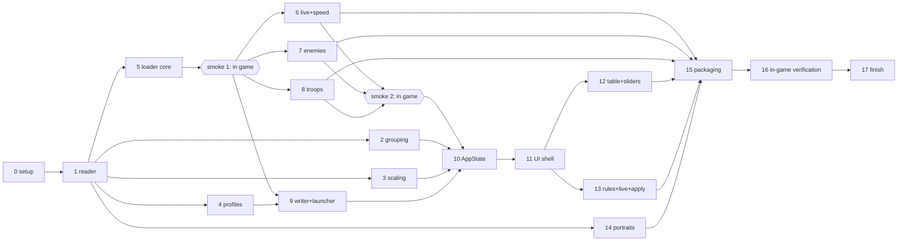

# KrGenesis Mod Implementation Plan

> **For agentic workers:** REQUIRED SUB-SKILL: Use superpowers:subagent-driven-development (recommended) or superpowers:executing-plans to implement this plan task-by-task. Steps use checkbox (- [ ]) syntax for tracking.

**Goal:** Build KrGenesis Mod, a native desktop app that edits every number in Kingdom Rush Genesis's balance.lua and delivers the changes, plus live speed, enemy count and troop count controls, through a Lua mod loaded with the game's -balance_override switch.

**Architecture:** A Python package (krmod) reads the original values from the game exe with the game's own lua51.dll, groups them into tabs, keeps changes in JSON profiles and shows them in a NiceGUI native window. Apply writes a fixed Lua loader (copied from mod_template\) plus two generated data files into the game's mods\ folder. The loader patches the balance table at every level start and installs once-per-session hooks for speed, enemy spawning and barracks counts, driven by a live file the app rewrites.

**Tech Stack:** Python 3.12.5 x64, NiceGUI native mode (pywebview + WebView2), psutil, Pillow, pytest + pytest-asyncio, ctypes over the game's lua51.dll (LuaJIT 2.1), Lua 5.1/LuaJIT for the loader, nicegui-pack (PyInstaller) for the exe.

**Spec:** docs/specs/2026-11-01-krgenesis-mod-design.md (on branch docs/mod-studio-design). During the build both documents are read from the local copy at kingdomrush-data-mod\.planning\ (Task 0), because code branches start from origin/main, which never carries the planning docs.

## Global Constraints

- Game folder: C:\Games\KR6.Genesis.TD.v1.01.008_LinkNeverDie.Com. Repo: its subfolder kingdomrush-data-mod\ (remote ttuyetdinh/kingdomrush-data-mod, private).
- Never modify Kingdom Rush Genesis.exe or any original game file. A normal launch must stay vanilla.
- Everything new lives in new folders inside the game folder. Nothing goes to %APPDATA%. NiceGUI storage and WebView2 data go under kingdomrush-data-mod\cache\.
- Never commit game files, bytecode, decompiled code, extracted art or the owner's profiles. The .gitignore blocks every *.lua except mod_template\**\*.lua. Test fixtures are hand-written Lua inside Python tests, never game-derived.
- Python and the packaged app are 64-bit (lua51.dll is x64).
- Original values are read at every start from the exe zip: run all/constants.lua, then kr6/data/balance/balance.lua, with luaL_loadbuffer (explicit length), never luaL_loadstring.
- Verified facts the tests pin: 5,857 numbers, 34 strings, 7 booleans, 1,665 tables, 0 aliased tables; towers.archers.price[1] = 70.
- Profile stores changes only (path → value). A change equal to its original is removed.
- Mod launch: Kingdom Rush Genesis.exe -balance_override mods.kr_mod, working directory = game folder.
- Live controls: speed 1/2/3; enemy_mult and troop_mult from 0.5 to 3 in 0.25 steps. Defaults 1. Speed keys default f5/f6/f7; forbidden keys: f1, f2, f3, space, escape, return, up, down, left, right.
- C1 slider: 50% to 300%, piecewise (left half 50→100, right half 100→300). Skips cells whose original is 0. C2 range: 0 to max(10, 3 × largest absolute original in the row).
- Rounding: whole-number originals give whole results (round half up, away from zero); decimal originals keep 2 decimals (round half up).
- Warn (allow, but flag) negative values, and 0 for any key containing cooldown or duration.
- Window title "KrGenesis Mod". Internal server binds 127.0.0.1 only. Exe: kingdomrush-data-mod\dist\KrGenesisMod\KrGenesisMod.exe.
- Git: work on feature branch feat/krgenesis-mod cut from origin/main, then git branch --unset-upstream; first push git push -u origin feat/krgenesis-mod. Parallel tasks use isolated worktrees merged back into that branch. No AI attribution in commits or PRs. No em-dashes in prose.
- The loader must never crash the game: every section runs under pcall and logs errors to mods\kr_mod_log.txt.

## Review Focus

1. A corrupt or hand-edited profile JSON: the app skips it with a visible warning and still starts (Task 4: test_corrupt_profile_skipped).
2. Typing non-numeric, empty or "1,5" text into a cell: rejected, the cell keeps its value, and enum or string paths are never editable (Task 10: test_parse_and_set_rejects_bad_text).
3. Deleting the active or the last profile: the app switches to another, or recreates "Default", and never ends up with no active profile (Task 4: test_delete_active_and_last).
4. The game exe missing, renamed or unreadable: the app opens with a clear error screen naming the expected path instead of crashing (Task 1: test_locate_missing_exe; Task 11: test_startup_error_page).
5. A log file left over from an earlier session: after Apply and run, the app reports only a log written after the apply moment (Task 9: test_logwatch_ignores_old_log).

## File Structure

```
kingdomrush-data-mod/
  pyproject.toml, requirements.lock, README.md, .gitignore
  krmod/
    __init__.py, __main__.py          entry: python -m krmod
    app.py                            startup: locate, read, index, self-check, run UI
    paths.py                          GamePaths, GameNotFoundError
    state.py                          AppState: the UI's single controller (pure Python)
    profiles.py                       Profile, LiveSettings, ProfileStore
    gamedata/luart.py                 LuaRuntime (ctypes over lua51.dll)
    gamedata/reader.py                read_balance(), walker script as a string constant
    model/values.py                   KeyPath, Leaf, BalanceTree, path_str, decode_damage_type
    model/grouping_rules.py           ordered placement rules (data)
    model/grouping.py                 Card, Placement, place(), GroupIndex, SelfCheck
    model/rows.py                     StatRow, build_rows(), friendly_label()
    model/categories.py               category_of()
    model/scaling.py                  slider math, rounding, warnings
    modgen/luafmt.py                  to_lua()
    modgen/writer.py                  atomic_write, apply_mod, write_live
    modgen/launcher.py                find_game, launch, apply_and_run
    modgen/logwatch.py                LogWatcher, LogSummary
    assets/portraits.py               portrait_for() best effort
    ui/main.py, topbar.py, cards.py, table.py, sliders.py, rules.py, applybar.py
  mod_template/
    kr_mod.lua                        entry, runs at every level start
    kr_mod/util.lua, stats.lua, unlock.lua, live.lua, enemies.lua, troops.lua
  scripts/build.bat
  tests/ (conftest.py, lua_harness.py, test_*.py)
```

Parallel waves (each wave's tasks are independent of each other):



The two smoke checkpoints (end of Task 5, end of Task 8) put the real game in the loop early (spec section 12). Tasks 6-9 start only after smoke 1 passes; Task 10 and later start only after smoke 2 passes. A failure goes back to the owning Lua task before anything builds on it.

## Shared Contracts

These formats cross task boundaries. Every task that touches them uses them exactly.

**KeyPath:** tuple[str | int, ...]. Integer segments are Lua array indices. path_str(("towers","archers","price",1)) == "towers.archers.price.1". The Lua loader logs paths in the same dotted form.

**mods\kr_mod_data.lua** (written by Task 9, read by the loader):

```lua
return {
  version = 1,
  changes = {
    { p = { "towers", "archers", "price", 1 }, v = 7 },
  },
  rules = { unlock_tower_levels = false },
  speed_keys = { "f5", "f6", "f7" },
}
```

**mods\kr_mod_live.lua** (written atomically by Task 9, polled by the loader): return { speed = 1, enemy_mult = 1, troop_mult = 1 }

**Loader session table:** global KRMOD = { installed = {}, originals = {}, live = { speed = 1, enemy_mult = 1, troop_mult = 1 }, speed_keys = { "f5","f6","f7" }, pollers = {}, enemy_acc = 0, data = <last data table>, base = <game dir> }.

**Loader module shape:** each file in mod_template\kr_mod\ returns a table M. Feature modules expose M.install(K, ctx), where K is KRMOD and ctx = { base = <game dir>, log = function(line) }. install is called at every level start and must guard its own hooks with K.installed.<name>.

**Log lines** (mods\kr_mod_log.txt, truncated at each level start, appended by live events):
- applied <n> changes
- missing <dotted path>
- unlock <label>: removed <n>, kept <m>
- speed x<n>
- enemies x<mult>
- troops x<mult>: <n> barracks
- error <text>

**Profile JSON** (profiles\<slug>.json; slug = name lowercased, runs of non [a-z0-9] → "-", trimmed):

```json
{"version": 1, "name": "Easy mode",
 "changes": [{"path": ["towers", "archers", "price", 1], "value": 7}],
 "rules": {"unlock_tower_levels": false},
 "live": {"speed": 1, "enemy_mult": 1.0, "troop_mult": 1.0},
 "speed_keys": ["f5", "f6", "f7"]}
```

profiles\_active.json holds {"active": "<name>"}.

---

### Task 0: Branch and planning copy

**Files:**
- Create: kingdomrush-data-mod\.planning\ (local only) with the spec, this plan and docs\mockups\*

- [ ] **Step 1: Copy the planning docs out of git**

From kingdomrush-data-mod on branch docs/mod-studio-design, copy docs\specs\, docs\plans\ and docs\mockups\ into .planning\ (same subfolders).

- [ ] **Step 2: Cut the feature branch**

```bash
git fetch origin
git checkout -b feat/krgenesis-mod origin/main
git branch --unset-upstream
```

Expected: working tree has only .gitignore, and .planning\ is still present (untracked).

- [ ] **Step 3: Ignore local-only folders**

Add to .gitignore: .planning/ and .nicegui/. Run git status: .planning must not be listed.

- [ ] **Step 4: Commit and first push**

```bash
git add .gitignore
git commit -m "Ignore local planning copy and NiceGUI storage"
git push -u origin feat/krgenesis-mod
```

### Task 1: Project scaffold, paths and balance reader

**Files:**
- Create: pyproject.toml, requirements.lock, krmod\__init__.py, krmod\paths.py, krmod\gamedata\__init__.py, krmod\gamedata\luart.py, krmod\gamedata\reader.py, krmod\model\__init__.py, krmod\model\values.py
- Test: tests\conftest.py, tests\test_paths.py, tests\test_luart.py, tests\test_reader.py

**Interfaces:**
- Produces:
  - paths.py: @dataclass(frozen=True) GamePaths(game_dir, exe, lua_dll, mods_dir, repo_dir, profiles_dir, cache_dir, mod_template_dir: Path); GamePaths.locate(repo_dir: Path | None = None) -> GamePaths; GamePaths.for_game_dir(game_dir: Path, repo_dir: Path) -> GamePaths; class GameNotFoundError(Exception) whose message names the missing path.
  - luart.py: class LuaError(RuntimeError); class LuaRuntime(dll_path: Path) with run(code: bytes | str, chunkname: str = "=chunk", want_result: bool = False) -> bytes | None, set_global_string(name: str, value: str) -> None, close(), context manager.
  - values.py: KeyPath; path_str(p) -> str; @dataclass(frozen=True) Leaf(path: KeyPath, value: float | str | bool, kind: Literal["num","str","bool"]) with properties is_enum (kind num and last str segment == "damage_type" or ends with "_damage_type") and is_whole; @dataclass BalanceTree(leaves: dict[KeyPath, Leaf], aliases: dict[KeyPath, KeyPath], damage_flags: dict[str, int], table_count: int) with numeric() -> list[Leaf] sorted by path_str and original(p) -> float; decode_damage_type(value: int, flags: dict[str, int]) -> str.
  - reader.py: read_balance(paths: GamePaths) -> BalanceTree; class ReaderError(Exception).

- [ ] **Step 1: Create pyproject.toml and the venv**

pyproject.toml: project name krgenesis-mod, requires-python ">=3.12", dependencies nicegui[native], psutil, Pillow; optional dev: pytest, pytest-asyncio. [tool.pytest.ini_options] testpaths = ["tests"], asyncio_mode = "auto".

```bash
python -m venv .venv
.venv\Scripts\python -m pip install -e .[dev]
.venv\Scripts\python -m pip freeze > requirements.lock
```

Expected: install succeeds and .venv is ignored by git.

- [ ] **Step 2: Write the failing tests**

tests\conftest.py: session fixture game_paths = GamePaths.locate() that calls pytest.skip when GameNotFoundError is raised; session fixture tree = read_balance(game_paths); fixture lua(game_paths) yielding a LuaRuntime.

```python
def test_locate_finds_game(game_paths):
    assert game_paths.exe.name == "Kingdom Rush Genesis.exe"
    assert game_paths.mods_dir == game_paths.game_dir / "mods"
    assert game_paths.repo_dir == Path(krmod.__file__).resolve().parents[1]

def test_locate_missing_exe(tmp_path):
    repo = tmp_path / "kingdomrush-data-mod"; repo.mkdir()
    with pytest.raises(GameNotFoundError, match="Kingdom Rush Genesis.exe"):
        GamePaths.locate(repo)

def test_run_returns_result(lua):
    assert lua.run("return 1 + 1", want_result=True) == b"2"

def test_syntax_error_raises(lua):
    with pytest.raises(LuaError, match="near"):
        lua.run("return (")

def test_bytecode_with_nul_loads(lua):
    blob = lua.run("return string.dump(function() return 42 end)", want_result=True)
    assert b"\x00" in blob
    lua.run(blob, "=dumped")  # must not raise

def test_counts(tree):
    kinds = Counter(l.kind for l in tree.leaves.values())
    assert kinds == {"num": 5857, "str": 34, "bool": 7}
    assert tree.table_count == 1665 and tree.aliases == {}

def test_known_values(tree):
    assert tree.original(("towers", "archers", "price", 1)) == 70
    leaf = tree.leaves[("enemies", "demons", "demon_lord", "basic_attack", "damage_type")]
    assert leaf.is_enum and decode_damage_type(int(leaf.value), tree.damage_flags) == "Physical"
    hit = tree.leaves[("towers", "catapult", "ultimate", "hit_damage_type")]
    assert decode_damage_type(int(hit.value), tree.damage_flags) == "Explosion"
    assert tree.damage_flags["DAMAGE_PHYSICAL"] == 2

def test_decode_combined_flags():
    flags = {"DAMAGE_PHYSICAL": 2, "DAMAGE_NO_DODGE": 33554432, "DAMAGE_ALL": 4294967295}
    assert decode_damage_type(2 | 33554432, flags) == "Physical + No dodge"

def test_read_is_fast(game_paths):
    t = time.perf_counter(); read_balance(game_paths); assert time.perf_counter() - t < 5
```

- [ ] **Step 3: Run tests to verify they fail**

Run: .venv\Scripts\python -m pytest tests\test_paths.py tests\test_luart.py tests\test_reader.py -v
Expected: FAIL (ImportError: krmod.paths)

- [ ] **Step 4: Implement paths.py**

locate: repo_dir defaults to Path(sys.executable).resolve().parents[2] when sys.frozen, else Path(__file__).resolve().parents[1]. game_dir = the KRMOD_GAME_DIR environment variable when set (so isolated worktrees outside the game folder can still run game-backed tests), else repo_dir.parent. Raise GameNotFoundError if game_dir\Kingdom Rush Genesis.exe or lua51.dll is missing. mod_template_dir = Path(sys._MEIPASS) / "mod_template" when frozen, else repo_dir / "mod_template". profiles_dir = repo_dir\profiles, cache_dir = repo_dir\cache. Test fixtures derive variants with dataclasses.replace.

- [ ] **Step 5: Implement luart.py**

ctypes.CDLL on lua51.dll with explicit argtypes/restype for luaL_newstate, luaL_openlibs, luaL_loadbuffer, lua_pcall, lua_tolstring (with size_t out-length), lua_settop, lua_gettop, lua_pushlstring, lua_setfield, lua_close. Globals index is -10002. run() restores the stack top after reading the result; errors pop the message into LuaError.

- [ ] **Step 6: Implement values.py and reader.py**

decode_damage_type: names from flags whose key starts with DAMAGE_, skipping DAMAGE_ALL, DAMAGE_ALL_FLAGS, DAMAGE_ALL_TYPES, DAMAGE_BASE_TYPES and DAMAGE_NONE, only single-bit values; label = key minus "DAMAGE_", lowercased, underscores to spaces, first letter capitalized; join set bits in ascending bit order with " + "; 0 gives "None".

read_balance: open the exe with zipfile, run all/constants.lua then kr6/data/balance/balance.lua (chunk names "@all/constants.lua", "@kr6/data/balance/balance.lua"), store the result in a global, then run a Lua walker (a string constant in reader.py) that returns one string. Walker line format, tab separated: num|str|bool, value, then path segments each prefixed s: or n:; "alias" lines carry two paths joined by a NUL-free separator; "const" lines carry name and value for DAMAGE_* globals; one "tables <n>" line. Numbers use string.format("%.17g"). Visited tables are tracked so an alias is reported once and not walked twice. Wrap any failure in ReaderError naming the zip entry.

- [ ] **Step 7: Run tests to verify they pass**

Run: .venv\Scripts\python -m pytest tests -v
Expected: all PASS

- [ ] **Step 8: Commit**

```bash
git add pyproject.toml requirements.lock krmod tests
git commit -m "Read original balance values from the game exe"
```

### Task 2: Grouping, rows and slider categories

**Files:**
- Create: krmod\model\grouping_rules.py, krmod\model\grouping.py, krmod\model\rows.py, krmod\model\categories.py
- Test: tests\test_grouping.py, tests\test_rows.py, tests\test_categories.py

**Interfaces:**
- Consumes: KeyPath, Leaf, BalanceTree, path_str (Task 1).
- Produces:
  - Tab = Literal["Towers","Troops","Heroes","Skills","Enemies","Items","Stages"]
  - @dataclass(frozen=True) Card(id: str, tab: Tab, title: str, group: str, prefix: KeyPath)
  - @dataclass(frozen=True) Placement(home: Card, extra: tuple[Card, ...])
  - place(path: KeyPath) -> Placement
  - GroupIndex.build(tree: BalanceTree) -> GroupIndex with cards(tab: Tab) -> list[Card], card(card_id: str) -> Card, paths_of(card_id: str) -> list[KeyPath] (home and extra placements, sorted), placement(path) -> Placement, self_check() -> SelfCheck(total: int, placed: int, unplaced: list[KeyPath], other: list[KeyPath])
  - @dataclass(frozen=True) StatRow(id: str, group: str, label: str, cells: tuple[KeyPath | None, ...], is_enum: bool, read_only: bool); build_rows(card: Card, paths: list[KeyPath], tree: BalanceTree) -> list[StatRow]; friendly_label(key: str) -> str. GroupIndex places every leaf (numbers, strings, booleans), so strings and booleans appear as read-only rows; read_only = is_enum or kind != "num". self_check counts numeric leaves only.
  - CATEGORY_NAMES = ("All costs", "All damage", "All range", "All cooldowns", "All HP"); category_of(path: KeyPath) -> str | None

Placement rules, first match wins (grouping_rules.py holds them as an ordered data table; TROOP_SEGMENTS = {"soldier", "special_soldier", "clone", "seedling"}, SKILL_SEGMENT = skill_* | ultimate | talent_*):

| # | Path pattern | Home card id (tab) | Extra |
|---|---|---|---|
| 1 | any path whose segment at index ≥ 2 is a troop segment | troops/<dotted prefix through the troop segment> (Troops), group by root: Towers, Classic towers, Spells, Heroes, Stages | none |
| 2 | towers.common.* | towers/common (Towers), title "Common" | none |
| 3 | towers.upgrades.* | towers/upgrades (Towers), title "Tower upgrades" | none |
| 4 | towers.<t>.<SKILL>.* | towers/<t> (Towers) | skills/towers/<t> |
| 5 | towers.<t>.* | towers/<t> (Towers) | none |
| 6 | kr1_mode.towers.<t>.<SKILL>.* | towers/kr1/<t> (Towers), title "Classic <T>" | skills/towers/kr1/<t> |
| 7 | kr1_mode.towers.<t>.* | towers/kr1/<t> (Towers) | none |
| 8 | kr1_mode.upgrades.* | skills/kr1_upgrades (Skills), title "Classic upgrades" | none |
| 9 | heroes.common.* | heroes/common (Heroes) | none |
| 10 | heroes.<h>.<SKILL>.* | heroes/<h> (Heroes), title without "hero_" | skills/heroes/<h> |
| 11 | heroes.<h>.* | heroes/<h> (Heroes) | none |
| 12 | powers.<p>.* | skills/powers/<p> (Skills), group "Spells" | none |
| 13 | upgrades.power_<p>.* | skills/powers/<p> (Skills) | none |
| 14 | enemies.jt_boss.* and enemies.lord_blackburn_boss.* | enemies/<boss> (Enemies), group "Bosses" | none |
| 15 | enemies.<faction>.<e>.* | enemies/<faction>/<e> (Enemies), group = friendly faction | none |
| 16 | items.<i>.* | items/<i> (Items) | none |
| 17 | specials.towers.<t>.* and specials.heroes.<h>.* | stages/<towers or heroes>/<name> (Stages) | none |
| 18 | specials.<s>.* | stages/<s> (Stages) | none |
| 19 | anything else | other/<tab> titled "Other", tab by root: towers and kr1_mode → Towers, heroes → Heroes, enemies → Enemies, items → Items, powers and upgrades → Skills, otherwise Stages | none |

Rows: a numeric leaf whose last segment is an int and whose parent table holds only consecutive int keys from 1 becomes one cell of the row for the parent path (cell index = int − 1). Any other leaf is a one-cell row. Row group = dotted segments between card.prefix and the row's last segment ("" for the unit's own stats); the group "stats" under heroes.<h> is labeled "Hero screen bars". Rows sort by group ("" first), then key. friendly_label: underscores to spaces, first letter upper, "hp" → "HP", "s " prefix dropped, trailing "max"/"min" become " (max)"/" (min)" (damage_min → "Damage (min)").

Categories, by the last string segment k of the path:
- All costs: k in {price, prices, cost, repair_cost, knight_cost, attack_cost, attack_cost_iron}
- All damage: "damage" in k and none of type, radius, factor, every, cap, inc, mult in k
- All range: "range" or "radius" in k and none of factor, inc, unit, offset in k
- All cooldowns: "cooldown" in k and none of factor, inc, decrease in k
- All HP: k in {hp, hp_max, hp_base, health, min_hp_max, max_hp_max}
- otherwise None; enum leaves always None.

- [ ] **Step 1: Write the failing tests**

```python
def test_every_number_has_one_home(tree):
    sc = GroupIndex.build(tree).self_check()
    assert (sc.total, sc.placed, sc.unplaced) == (5857, 5857, [])

def test_tower_and_skill_placement():
    p = place(("towers","archers","price",1)); assert p.home.id == "towers/archers" and p.extra == ()
    p = place(("towers","knights","skill_a","cooldown",1))
    assert p.home.id == "towers/knights" and [c.id for c in p.extra] == ["skills/towers/knights"]

def test_troops_and_specials():
    assert place(("towers","knights","soldier","hp_max",1)).home.tab == "Troops"
    assert place(("specials","towers","stage_07_barn","soldier","hp_max")).home.tab == "Troops"
    assert place(("powers","reinforcements","special_soldier","hp_max")).home.tab == "Troops"
    assert place(("specials","towers","stage_07_barn","max_soldiers")).home.id == "stages/towers/stage_07_barn"

def test_heroes_spells_enemies():
    assert place(("heroes","hero_bolin","stats","hp")).home.id == "heroes/hero_bolin"
    assert place(("upgrades","power_rain_of_fire","x")).home.id == "skills/powers/rain_of_fire"
    e = place(("enemies","demons","demon_lord","hp"))
    assert (e.home.id, e.home.group) == ("enemies/demons/demon_lord", "Demons")
    assert place(("enemies","jt_boss","hp")).home.group == "Bosses"

def test_unknown_goes_to_other():
    assert place(("kr1_mode","mystery",1)).home.id == "other/Towers"

def test_price_row(tree):
    idx = GroupIndex.build(tree); card = idx.card("towers/archers")
    rows = {r.id: r for r in build_rows(card, idx.paths_of(card.id), tree)}
    price = rows["price"]
    assert price.cells[0] == ("towers","archers","price",1) and price.label == "Price"

def test_hero_bars_label(tree):
    idx = GroupIndex.build(tree); card = idx.card("heroes/hero_bolin")
    assert any(r.group == "Hero screen bars" for r in build_rows(card, idx.paths_of(card.id), tree))

@pytest.mark.parametrize("path,cat", [
    (("towers","archers","price",1), "All costs"),
    (("x","damage_min",1), "All damage"), (("x","damage_type"), None),
    (("x","damage_radius"), "All range"), (("x","cooldown",2), "All cooldowns"),
    (("x","cooldown_factor"), None), (("x","hp_max",1), "All HP"), (("x","lives_cost"), None),
    (("x","damage_factor"), None), (("x","cost_factor"), None), (("x","skill_cost_red_factor"), None),
    (("x","damage_cap"), None), (("x","range_factor"), None)])
def test_category_of(path, cat):
    assert category_of(path) == cat

def test_friendly_label():
    assert friendly_label("damage_min") == "Damage (min)" and friendly_label("hp_max") == "HP (max)"
```

- [ ] **Step 2: Run tests to verify they fail**

Run: .venv\Scripts\python -m pytest tests\test_grouping.py tests\test_rows.py tests\test_categories.py -v
Expected: FAIL (ImportError)

- [ ] **Step 3: Implement grouping_rules.py, grouping.py, rows.py, categories.py** per the tables above.

- [ ] **Step 4: Run tests to verify they pass**

Run: .venv\Scripts\python -m pytest tests -v
Expected: all PASS

- [ ] **Step 5: Commit**

```bash
git add krmod/model tests
git commit -m "Group balance values into tabs, cards and level rows"
```

### Task 3: Slider math, rounding and warnings

**Files:**
- Create: krmod\model\scaling.py
- Test: tests\test_scaling.py

**Interfaces:**
- Consumes: KeyPath (Task 1).
- Produces: PCT_MIN = 50.0, PCT_MAX = 300.0; track_to_pct(t: float) -> float; pct_to_track(p: float) -> float; scale(original: float, pct: float) -> float; common_pct(pairs: Sequence[tuple[float, float]]) -> float | None; c2_range(originals: Sequence[float]) -> tuple[float, float]; warn(path: KeyPath, value: float) -> str | None.

common_pct takes (original, current) pairs and ignores pairs with original 0. With no nonzero pair it returns 100.0. Otherwise the candidate is current/original × 100 from the pair with the largest absolute original, rounded to 0.1. It returns the candidate if scale(original, candidate) == current for every nonzero pair, else None ("mixed"). scale uses Decimal with ROUND_HALF_UP.

- [ ] **Step 1: Write the failing tests**

```python
@pytest.mark.parametrize("t,p", [(0,50),(0.25,75),(0.5,100),(0.75,200),(1,300)])
def test_track_mapping(t, p):
    assert track_to_pct(t) == p and pct_to_track(p) == t

@pytest.mark.parametrize("orig,pct,out", [(70,50,35),(75,133.3,100),(0.5,150,0.75),(1.33,50,0.67),(3,150,5),(-4,50,-2)])
def test_scale(orig, pct, out):
    assert scale(orig, pct) == out

def test_common_pct():
    assert common_pct([(70,35),(110,55)]) == 50
    assert common_pct([(70,35),(110,110)]) is None
    assert common_pct([(0,5),(70,140)]) == 200
    assert common_pct([(75,100),(3,4)]) == 133.3
    assert common_pct([(0,0)]) == 100

def test_c2_range():
    assert c2_range([1,2]) == (0,10) and c2_range([70,110]) == (0,330)

def test_warn():
    assert warn(("t","cooldown",1), 0) and warn(("t","stun_duration"), 0)
    assert warn(("t","hp",1), -1) and warn(("t","hp",1), 0) is None
```

- [ ] **Step 2: Run to verify failure**: .venv\Scripts\python -m pytest tests\test_scaling.py -v → FAIL (ImportError)
- [ ] **Step 3: Implement scaling.py**
- [ ] **Step 4: Run to verify pass**: same command → PASS
- [ ] **Step 5: Commit**: git add krmod/model/scaling.py tests/test_scaling.py; git commit -m "Add slider math and rounding rules"

### Task 4: Profiles

**Files:**
- Create: krmod\profiles.py
- Test: tests\test_profiles.py

**Interfaces:**
- Consumes: KeyPath, BalanceTree (Task 1).
- Produces: @dataclass LiveSettings(speed: int = 1, enemy_mult: float = 1.0, troop_mult: float = 1.0) with validate(); @dataclass Profile(name: str, changes: dict[KeyPath, float] = field(default_factory=dict), unlock_tower_levels: bool = False, live: LiveSettings = field(default_factory=LiveSettings), speed_keys: tuple[str, str, str] = ("f5","f6","f7")); class ProfileError(ValueError); FORBIDDEN_KEYS; validate_speed_keys(keys: Sequence[str]) -> tuple[str, str, str]; class ProfileStore(dir: Path) with names() -> list[str], active() -> Profile, switch(name), create(name) -> Profile, duplicate(src: str, new: str) -> Profile, rename(old: str, new: str), delete(name), save(profile), load_warnings: list[str]; stale_changes(profile: Profile, tree: BalanceTree) -> list[KeyPath].

Rules: names are non-empty after strip and unique case-insensitively, else ProfileError. A store with no profiles creates "Default" and makes it active. The active name persists in _active.json and reopens on start. Deleting the active profile switches to the first remaining name; deleting the last one recreates "Default". Rename moves the file and keeps it active if it was. Saving writes atomically (temp file + os.replace). A file that fails to parse is skipped and its file name added to load_warnings. Speed keys must be 3 distinct LÖVE key names not in FORBIDDEN_KEYS. A stale change is a path missing from tree.leaves or not numeric or an enum.

- [ ] **Step 1: Write the failing tests**

```python
def test_first_run_creates_default(tmp_path):
    s = ProfileStore(tmp_path); assert s.names() == ["Default"] and s.active().name == "Default"

def test_round_trip_keeps_int_segments(tmp_path):
    s = ProfileStore(tmp_path); p = s.active(); p.changes[("towers","archers","price",1)] = 7; s.save(p)
    assert ProfileStore(tmp_path).active().changes == {("towers","archers","price",1): 7}

def test_create_duplicate_rename_switch(tmp_path):
    s = ProfileStore(tmp_path); s.create("Easy"); s.duplicate("Easy", "Hard"); s.rename("Hard", "Brutal")
    s.switch("Brutal"); assert ProfileStore(tmp_path).active().name == "Brutal"
    with pytest.raises(ProfileError): s.create("easy")
    with pytest.raises(ProfileError): s.create("  ")

def test_delete_active_and_last(tmp_path):
    s = ProfileStore(tmp_path); s.create("Easy"); s.switch("Easy"); s.delete("Easy")
    assert s.active().name == "Default"; s.delete("Default"); assert s.names() == ["Default"]

def test_corrupt_profile_skipped(tmp_path):
    (tmp_path / "broken.json").write_text("{nope"); s = ProfileStore(tmp_path)
    assert "broken.json" in s.load_warnings[0] and s.active().name == "Default"

def test_speed_keys_validation():
    assert validate_speed_keys(["f5","f6","f7"]) == ("f5","f6","f7")
    for bad in (["f1","f6","f7"], ["f5","f5","f7"], ["space","f6","f7"]):
        with pytest.raises(ProfileError): validate_speed_keys(bad)

def test_live_validation():
    LiveSettings(3, 0.5, 3.0).validate()
    for bad in (LiveSettings(4), LiveSettings(enemy_mult=0.6), LiveSettings(troop_mult=3.25)):
        with pytest.raises(ProfileError): bad.validate()

def test_stale(tree, tmp_path):
    p = ProfileStore(tmp_path).active()
    p.changes = {("towers","archers","price",1): 7, ("towers","gone",1): 1}
    assert stale_changes(p, tree) == [("towers","gone",1)]
```

- [ ] **Step 2: Run to verify failure**: .venv\Scripts\python -m pytest tests\test_profiles.py -v → FAIL
- [ ] **Step 3: Implement profiles.py**
- [ ] **Step 4: Run to verify pass** → PASS
- [ ] **Step 5: Commit**: git commit -m "Add named profiles with auto-save"

### Task 5: Loader core: entry, stats patch, unlock, Lua test harness

**Files:**
- Create: mod_template\kr_mod.lua, mod_template\kr_mod\util.lua, mod_template\kr_mod\stats.lua, mod_template\kr_mod\unlock.lua, krmod\modgen\__init__.py, krmod\modgen\luafmt.py, tests\lua_harness.py
- Test: tests\test_luafmt.py, tests\test_mod_stats.py, tests\test_mod_unlock.py

**Interfaces:**
- Consumes: LuaRuntime (Task 1); Shared Contracts above.
- Produces:
  - luafmt.to_lua(obj) -> str: dict → { key = v } (identifier keys bare, others ["k"] / [n]), list/tuple → { a, b }, bool, int, float (repr, finite only, else ValueError), str (double-quoted, escaping backslash, quote, \n, \r, \0).
  - Lua util.lua: M.log_open(path), M.log(line), M.load_table(path) -> table | nil, err (loadfile + setfenv(chunk, {}) + pcall; returns nil when the file is missing, unparsable or does not return a table), M.load_module(base, name) -> table | nil (dofile of base.."/mods/kr_mod/"..name..".lua" under pcall).
  - Lua stats.lua: M.find_balance() -> table | nil, source (debug.getlocal over stack levels 2-12 for a local named balance holding a table with a towers field); M.apply(balance, changes, K) -> applied: number, missing: { dotted path }.
  - Lua unlock.lua: M.strip(list) -> removed, kept; M.apply_current(store, enabled, log); M.install(K, LU, is_enabled, log).
  - tests\lua_harness.py: class ModHarness(tmp_path: Path, dll: Path) with write_data(changes: list[tuple[KeyPath, float]] = [], unlock: bool = False, speed_keys=("f5","f6","f7")), write_live(speed=1, enemy_mult=1.0, troop_mult=1.0), write_raw(name: str, text: str), lua(code: str) -> str | None, run_level(balance_expr: str = "BAL"), log() -> str, plus attributes game_dir and mods_dir. It copies mod_template\ into game_dir\mods\ and installs the stubs below in one LuaRuntime.

Harness stubs (Lua globals created by ModHarness, used by Tasks 5-8):
- NOW = 0; love = { filesystem = { getSourceBaseDirectory = <game_dir with forward slashes> }, timer = { getTime = function() return NOW end }, graphics = { print = record into PRINTS, getColor, setColor, push, pop, origin, getWidth = 1920 }, getVersion = 11, 4, 0 }
- game = { DBG_TIME_MULT = 1, store = { entities = {}, level = nil }, update = counts GAME_UPDATES, keypressed = sets LAST_KEY, draw = counts DRAWS }
- package.preload: level_utils = { load_data = function(st) return LEVEL_DATA end }; entity_db = { entities = {}, get_template = function(self, n) return self.entities[n] end }; systems = { wave_spawn_tsv = { cmd_fns = { spawn = <stub from Task 7 or a recorder> } } }; utils = { y_wait = function(store, t) table.insert(WAITS, t) end }
- F_BOSS = 0x10000; package.path = game_dir.."/?.lua;"..package.path
- run_level executes: local function templates_game() local balance = <balance_expr>; package.loaded["mods.kr_mod"] = nil; return require("mods.kr_mod") end; RESULT = templates_game()

kr_mod.lua order at each run, every step under pcall with "error <msg>" logging:
1. base, KRMOD init (Shared Contracts), util loaded by dofile, log_open truncates the log.
2. data = util.load_table(base.."/mods/kr_mod_data.lua"), or { changes = {}, rules = {} } with "error data: <msg>". K.data = data; K.speed_keys = data.speed_keys or defaults.
3. balance = stats.find_balance(); none → "error balance local not found". Else stats.apply, log "applied <n> changes" and one "missing" line each, then package.loaded["data.balance.balance"] = balance.
4. unlock.apply_current(game and game.store, data.rules.unlock_tower_levels, log); unlock.install(K, require("level_utils"), function() return K.data.rules.unlock_tower_levels end, log).
5. For name in { "live", "enemies", "troops" }: m = util.load_module(base, name); if m then m.install(K, ctx) else log "error module <name> missing".
6. return true.

stats.apply: first restore every entry in K.originals (key = dotted path; value { p = path, v = original }). Then, for each change, walk p through tables; if a step is not a table or the final value is not a number, log it as missing and create nothing. Otherwise record the original once in K.originals and write v.

unlock: strip removes string entries matching "_lvl%d+$" in place and keeps everything else in order. apply_current strips store.level.locked_towers and store.level.data.locked_towers when enabled (label "<level_name> mode <level_mode>"). install wraps LU.load_data once (K.installed.unlock): it calls the original, then strips data.locked_towers when is_enabled() is true.

- [ ] **Step 1: Write the failing tests**

```python
def test_to_lua():
    assert to_lua({"a": 1, "b": [1.5, "x\"y"], 3: True}) == '{ a = 1, b = { 1.5, "x\\"y" }, [3] = true }'
    with pytest.raises(ValueError): to_lua(float("nan"))

BAL = 'BAL = { towers = { archers = { price = { 70, 110 } } } }'

def test_patch_then_restore(harness):
    harness.lua(BAL); harness.write_data([(("towers","archers","price",1), 7)]); harness.run_level()
    assert harness.lua("return BAL.towers.archers.price[1]") == "7"
    assert "applied 1 changes" in harness.log()
    assert harness.lua('return tostring(package.loaded["data.balance.balance"] == BAL)') == "true"
    harness.write_data([]); harness.run_level()
    assert harness.lua("return BAL.towers.archers.price[1]") == "70"

def test_missing_path_logged_not_created(harness):
    harness.lua(BAL); harness.write_data([(("towers","nope","price",1), 7)]); harness.run_level()
    assert "missing towers.nope.price.1" in harness.log()
    assert harness.lua("return tostring(BAL.towers.nope)") == "nil"

def test_no_balance_local_is_safe(harness):
    harness.lua(BAL); harness.write_data([]); harness.run_level("nil")
    assert "error balance local not found" in harness.log() and harness.lua("return tostring(RESULT)") == "true"

def test_bad_data_file_is_safe(harness):
    harness.lua(BAL); harness.write_raw("kr_mod_data.lua", "return {"); harness.run_level()
    assert "error data" in harness.log() and harness.lua("return tostring(RESULT)") == "true"

def test_unlock_strips_level_locks_only(harness):
    harness.lua(BAL + '; game.store.level = { locked_towers = { "tower_build_archers", "archers_lvl2", "knights_lvl4" } }')
    harness.write_data([], unlock=True); harness.run_level()
    assert harness.lua("return table.concat(game.store.level.locked_towers, ',')") == "tower_build_archers"
    assert "unlock" in harness.log() and "removed 2, kept 1" in harness.log()

def test_load_data_wrapped_once_and_respects_flag(harness):
    harness.lua(BAL + '; LEVEL_DATA = { locked_towers = { "archers_lvl2" } }')
    harness.write_data([], unlock=True)
    for _ in range(3): harness.run_level()
    assert harness.lua('return #require("level_utils").load_data({}).locked_towers') == "0"
    harness.lua('LEVEL_DATA = { locked_towers = { "archers_lvl2" } }')
    harness.write_data([], unlock=False); harness.run_level()
    assert harness.lua('return #require("level_utils").load_data({}).locked_towers') == "1"
```

The harness fixture lives in tests\conftest.py: ModHarness(tmp_path, game_paths.lua_dll).

- [ ] **Step 2: Run to verify failure**: .venv\Scripts\python -m pytest tests\test_luafmt.py tests\test_mod_stats.py tests\test_mod_unlock.py -v → FAIL
- [ ] **Step 3: Implement luafmt.py, the harness and the four Lua files**
- [ ] **Step 4: Run to verify pass** → PASS. Also run git check-ignore -v mod_template/kr_mod.lua mod_template/kr_mod/stats.lua and expect both NOT ignored (the command prints the negation rule).
- [ ] **Step 5: Commit**: git add mod_template krmod/modgen tests; git commit -m "Add mod loader core: stat patching and tower level unlock"
- [ ] **Step 6: Smoke 1, in game (owner plays)**

Copy mod_template\ into the game's mods\ folder (replacing the spike kr_mod.lua), hand-write mods\kr_mod_data.lua with towers.archers.price[1] = 7 and unlock_tower_levels = true, and mods\kr_mod_live.lua with speed 1 and both multipliers 1. Keep the spike's launch_modded.bat. The owner quits the game, runs mods\launch_modded.bat and plays stage 1. Pass: Archers cost 7; a tower upgrades to level 2; mods\kr_mod_log.txt shows "applied 1 changes", an unlock line with removed > 0 and no error lines (the "module live/enemies/troops missing" errors are expected at this point). Then the owner restarts the level from the pause menu and the log is rewritten. Record the result in .planning\verification.md.

### Task 6: Live polling, game speed, keys and badge

**Files:**
- Create: mod_template\kr_mod\live.lua
- Test: tests\test_mod_live.py

**Interfaces:**
- Consumes: ModHarness, util.load_table, KRMOD (Task 5).
- Produces: Lua M.install(K, ctx); M.read_live(path) -> table | nil (validated); M.poll(K, ctx). K.live is the current validated settings; K.pollers[name] = function(K) is called on every poll after settings are updated (Task 8 registers one).

Behavior: install (once, K.installed.live) reads the live file and sets game.DBG_TIME_MULT = live.speed, then wraps three functions on the global game table:
- update(self, dt): call the original, then poll when love.timer.getTime() − K.last_poll ≥ 0.5.
- keypressed(self, key, isrepeat): when key equals K.speed_keys[i], set game.DBG_TIME_MULT = i, log "speed x<i>" and return without calling the original. Any other key goes to the original unchanged.
- draw(self): call the original. When DBG_TIME_MULT > 1, draw "x2" or "x3" at the top right (love.graphics.print, x = getWidth() − 80, y = 12) inside push/origin/pop, saving and restoring the colour.

poll: re-read the file. Valid means speed ∈ {1, 2, 3} and both multipliers are numbers in [0.5, 3] with mult × 4 a whole number; invalid or unreadable reads are ignored. If the file's speed differs from the last file speed seen, apply it and log it. A key press therefore stays in force until the app changes the file. Copy enemy_mult and troop_mult into K.live, logging "enemies x<m>" when changed, then call every K.pollers function under pcall. The badge text is "x2"/"x3", not "×2", because the game font may lack the × glyph (builder's call).

- [ ] **Step 1: Write the failing tests**

```python
def setup(h, speed=1):
    h.lua('BAL = { towers = {} }'); h.write_data([]); h.write_live(speed=speed); h.run_level()

def test_start_speed_from_live_file(harness):
    setup(harness, speed=2); assert harness.lua("return game.DBG_TIME_MULT") == "2"

def test_speed_keys_consumed(harness):
    setup(harness); harness.lua('game:keypressed("f7")')
    assert harness.lua("return game.DBG_TIME_MULT") == "3" and harness.lua("return tostring(LAST_KEY)") == "nil"
    harness.lua('game:keypressed("a")'); assert harness.lua("return LAST_KEY") == "a"

def test_poll_applies_file_change_but_not_unchanged_file(harness):
    setup(harness); harness.lua('game:keypressed("f6")'); harness.lua("NOW = 1; game:update(0.03)")
    assert harness.lua("return game.DBG_TIME_MULT") == "2"
    harness.write_live(speed=3); harness.lua("NOW = 2; game:update(0.03)")
    assert harness.lua("return game.DBG_TIME_MULT") == "3"

def test_invalid_live_ignored(harness):
    setup(harness, speed=2); harness.write_raw("kr_mod_live.lua", "return { speed = 5, enemy_mult = 1, troop_mult = 1 }")
    harness.lua("NOW = 1; game:update(0.03)"); assert harness.lua("return game.DBG_TIME_MULT") == "2"
    harness.write_raw("kr_mod_live.lua", "return { speed = 1, enemy_mult = 0.6, troop_mult = 1 }")
    harness.lua("NOW = 2; game:update(0.03)"); assert harness.lua("return game.DBG_TIME_MULT") == "2"

def test_hooks_installed_once(harness):
    setup(harness); harness.run_level(); harness.run_level(); harness.lua("game:update(0.03)")
    assert harness.lua("return GAME_UPDATES") == "1"

def test_badge(harness):
    setup(harness, speed=1); harness.lua("game:draw()"); assert harness.lua("return #PRINTS") == "0"
    harness.lua('game:keypressed("f6"); game:draw()'); assert harness.lua("return PRINTS[1]") == "x2"
```

- [ ] **Step 2: Run to verify failure** → FAIL
- [ ] **Step 3: Implement live.lua**
- [ ] **Step 4: Run to verify pass** → PASS (whole suite)
- [ ] **Step 5: Commit**: git commit -m "Add live speed control with hotkeys and badge"

### Task 7: Enemy count multiplier

**Files:**
- Create: mod_template\kr_mod\enemies.lua
- Test: tests\test_mod_enemies.py

**Interfaces:**
- Consumes: ModHarness, KRMOD.live.enemy_mult (Task 6 keeps it current; tests set it directly).
- Produces: Lua M.install(K, ctx) wraps require("systems").wave_spawn_tsv.cmd_fns.spawn once (K.installed.enemies); M.plan(K, mult, kind) -> n with kind "boss" | "carrier" | "normal"; EXTRA_SPACING = 0.25.

Algorithm (spec 8.5), per entry o of cmd.spawns in order:
- kind: "boss" when E:get_template(o.enemy) has vis.flags with bit.band(flags, F_BOSS) ~= 0; "carrier" when store.gems_spawn_idx contains store.current_spawn_idx + 1; else "normal".
- plan: boss → 1 and K.enemy_acc is untouched. Otherwise K.enemy_acc += mult, n = floor(K.enemy_acc) (carrier: max(1, that)), K.enemy_acc −= n.
- n = 0: if the template exists, store.current_spawn_idx += 1; no spawn.
- n ≥ 1: call the original with a shallow copy of cmd whose spawns = { o } and whose wait_time is cmd.wait_time for the first entry of the command and 0 after. For a carrier, multiply store.gems_per_wave by mult for that call and restore it afterwards.
- Then n − 1 extras: each U.y_wait(store, EXTRA_SPACING) and then the original with wait_time 0, while store.gems_spawn_idx is temporarily {} and store.current_spawn_idx is saved and restored around the call.
- Stop processing the command as soon as store.force_next_wave is true.
- mult = 1: call the original with the untouched cmd (fast path, identical to vanilla).

Test stub for the original (installed by these tests before run_level): it records { enemy, wait_time, idx_before, gems_per_wave, ngems } into SPAWN_CALLS for each entry, increments store.current_spawn_idx, and returns early when store.force_next_wave is set. Templates: entity_db.entities.boss = { vis = { flags = F_BOSS } }, a = {}, b = {}.

- [ ] **Step 1: Write the failing tests**

```python
def spawn(h, enemies, mult, gems_idx=(), wait=1.0):
    return h.lua(f"""KRMOD.live.enemy_mult = {mult}; KRMOD.enemy_acc = 0; SPAWN_CALLS = {{}}; WAITS = {{}}
      local store = {{ current_spawn_idx = 0, gems_spawn_idx = {{ {",".join(map(str, gems_idx))} }}, gems_per_wave = 10 }}
      local cmd = {{ wait_time = {wait}, spawns = {{ {",".join(f'{{pi=1,spi=1,enemy="{e}"}}' for e in enemies)} }} }}
      require("systems").wave_spawn_tsv.cmd_fns.spawn(store, cmd, "w1")
      LAST_STORE = store; LAST_CMD = cmd; return #SPAWN_CALLS""")

def test_identity_at_1(enemy_h):
    assert spawn(enemy_h, ["a","b"], 1) == "2"

def test_double(enemy_h):
    assert spawn(enemy_h, ["a","b"], 2) == "4"
    assert enemy_h.lua("return LAST_STORE.current_spawn_idx") == "2"
    assert enemy_h.lua("return WAITS[1]") == "0.25" and enemy_h.lua("return #LAST_CMD.spawns") == "2"

def test_half_keeps_indices(enemy_h):
    assert spawn(enemy_h, ["a","b","a","b"], 0.5) == "2"
    assert enemy_h.lua("return LAST_STORE.current_spawn_idx") == "4"

def test_one_and_half(enemy_h):
    assert spawn(enemy_h, ["a","b"], 1.5) == "3"

def test_boss_never_multiplied(enemy_h):
    assert spawn(enemy_h, ["boss"], 3) == "1" and spawn(enemy_h, ["boss"], 0.5) == "1"

def test_carrier_kept_and_gems_scaled(enemy_h):
    assert spawn(enemy_h, ["a"], 0.5, gems_idx=(1,)) == "1"
    assert enemy_h.lua("return SPAWN_CALLS[1].gems_per_wave") == "5"
    assert enemy_h.lua("return LAST_STORE.gems_per_wave") == "10"
    spawn(enemy_h, ["a"], 2, gems_idx=(1,))
    assert enemy_h.lua("return SPAWN_CALLS[1].gems_per_wave .. ',' .. SPAWN_CALLS[2].ngems") == "20,0"

def test_wait_only_on_first(enemy_h):
    spawn(enemy_h, ["a","b"], 1.5, wait=2)
    assert enemy_h.lua("return SPAWN_CALLS[1].wait_time .. ',' .. SPAWN_CALLS[3].wait_time") == "2,0"

def test_installed_once(enemy_h):
    enemy_h.run_level(); enemy_h.run_level(); assert spawn(enemy_h, ["a"], 2) == "2"
```

enemy_h is a fixture: harness with BAL, data, live written, the stub original installed in package.preload systems, then run_level().

- [ ] **Step 2: Run to verify failure** → FAIL
- [ ] **Step 3: Implement enemies.lua**
- [ ] **Step 4: Run to verify pass** → PASS
- [ ] **Step 5: Commit**: git commit -m "Add live enemy count multiplier with linear rewards"

### Task 8: Troop count multiplier

**Files:**
- Create: mod_template\kr_mod\troops.lua
- Test: tests\test_mod_troops.py

**Interfaces:**
- Consumes: ModHarness, KRMOD.live.troop_mult, K.pollers (Task 6).
- Produces: Lua M.apply_barrack(b, mult) -> changed: boolean; M.apply_all(K) -> count of barrack tables touched; M.install(K, ctx) registers K.pollers.troops = M.apply_all. The first poll after a level start reaches the fresh templates, because templates are built after the mod runs.

apply_barrack (spec 8.5):
- number: if b._kr_applied == nil or b.max_soldiers ~= b._kr_applied then b._kr_base = b.max_soldiers. want = max(1, floor(b._kr_base × mult + 0.5)); write want to b.max_soldiers and b._kr_applied.
- table: the same per index, with b._kr_base_t and b._kr_applied_t.
- apply_all walks require("entity_db").entities (templates) and game.store.entities; for each value t with a table t.barrack it calls apply_barrack(t.barrack, K.live.troop_mult). It logs "troops x<m>: <n> barracks" only when mult changed since the last log.

- [ ] **Step 1: Write the failing tests**

```python
def test_scale_from_base_no_compounding(troop_h):
    troop_h.lua("B = { max_soldiers = 3 }; T = require('kr_mod_troops_under_test')")
    for _ in range(3): troop_h.lua("T.apply_barrack(B, 2)")
    assert troop_h.lua("return B.max_soldiers") == "6"
    troop_h.lua("T.apply_barrack(B, 1)"); assert troop_h.lua("return B.max_soldiers") == "3"

def test_script_rewrite_becomes_base(troop_h):
    troop_h.lua("B = { max_soldiers = 3 }; T.apply_barrack(B, 2); B.max_soldiers = 4; T.apply_barrack(B, 2)")
    assert troop_h.lua("return B.max_soldiers") == "8"

@pytest.mark.parametrize("base,mult,out", [(3,1.5,5),(1,0.5,1),(8,3,24),(2,0.5,1)])
def test_rounding(troop_h, base, mult, out):
    assert troop_h.lua(f"local b = {{ max_soldiers = {base} }}; T.apply_barrack(b, {mult}); return b.max_soldiers") == str(out)

def test_per_level_table(troop_h):
    troop_h.lua("B = { max_soldiers = { 2, 3, 4 } }; T.apply_barrack(B, 2); T.apply_barrack(B, 2)")
    assert troop_h.lua("return table.concat(B.max_soldiers, ',')") == "4,6,8"

def test_templates_and_live_entities(troop_h):
    troop_h.lua("""local E = require('entity_db'); E.entities.knights = { barrack = { max_soldiers = 3 } }
      game.store.entities[7] = { barrack = { max_soldiers = 3 } }; game.store.entities[8] = { hp = 1 }
      KRMOD.live.troop_mult = 2; KRMOD.pollers.troops(KRMOD)""")
    assert troop_h.lua("return require('entity_db').entities.knights.barrack.max_soldiers") == "6"
    assert troop_h.lua("return game.store.entities[7].barrack.max_soldiers") == "6"
    assert "troops x2: 2 barracks" in troop_h.log()

def test_copied_template_keeps_base(troop_h):
    troop_h.lua("B = { max_soldiers = 3 }; T.apply_barrack(B, 2); C = { max_soldiers = B.max_soldiers, _kr_base = B._kr_base, _kr_applied = B._kr_applied }; T.apply_barrack(C, 1)")
    assert troop_h.lua("return C.max_soldiers") == "3"
```

troop_h: harness after run_level(), with package.preload["kr_mod_troops_under_test"] returning dofile(<mods>/kr_mod/troops.lua) and T bound globally.

- [ ] **Step 2: Run to verify failure** → FAIL
- [ ] **Step 3: Implement troops.lua**
- [ ] **Step 4: Run to verify pass** → PASS
- [ ] **Step 5: Commit**: git commit -m "Add live troop count multiplier"
- [ ] **Step 6: Smoke 2, in game (owner plays)**

Copy the full mod_template\ into mods\ again and keep the hand-written data file. With the game running on a mid-game stage: press F6, then F7, then F5 (speed changes, badge shows and clears, pause still pauses); edit mods\kr_mod_live.lua by hand to enemy_mult = 2 and confirm doubled spawn groups with one boss on a boss wave; set troop_mult = 2 and confirm a Knights barracks refills to 6 and new Knights towers start with 6. Pass when the log shows the speed, enemies and troops lines and no error lines, with no crash or stuck wave. Record the result in .planning\verification.md.

### Task 9: Mod writer, launcher and log watcher

**Files:**
- Create: krmod\modgen\writer.py, krmod\modgen\launcher.py, krmod\modgen\logwatch.py
- Test: tests\test_writer.py, tests\test_launcher.py, tests\test_logwatch.py

**Interfaces:**
- Consumes: GamePaths, BalanceTree, LuaRuntime (Task 1); Profile, LiveSettings, stale_changes (Task 4); to_lua (Task 5); mod_template\ contents (Tasks 5-8).
- Produces:
  - writer: atomic_write(path: Path, text: str, retries: int = 5) -> None (temp file in the same folder, os.replace, retry PermissionError every 50 ms); data_table(profile, tree) -> dict per Shared Contracts (stale and equal-to-original changes left out, paths sorted by path_str); apply_mod(paths, profile, tree) -> ApplyResult(files: list[Path], applied: int, stale: list[KeyPath]); write_live(paths, live: LiveSettings) -> None; LAUNCH_BAT text constant.
  - launcher: GAME_EXE_NAME = "Kingdom Rush Genesis.exe"; @dataclass RunningGame(pid: int, modded: bool); find_game(paths) -> RunningGame | None (psutil.process_iter(["name","exe","cmdline"]), exe path equal to paths.exe, modded = "-balance_override" in cmdline, AccessDenied entries skipped); launch(paths) -> int (Popen [exe, "-balance_override", "mods.kr_mod"], cwd = game_dir, creationflags DETACHED_PROCESS | CREATE_NEW_PROCESS_GROUP, returns the pid); class RunOutcome(Enum): LAUNCHED, UPDATED_RUNNING, NEEDS_RESTART; apply_and_run(paths, profile, tree) -> tuple[RunOutcome, ApplyResult]. Files are always written; it launches only when no game is running.
  - logwatch: @dataclass LogSummary(applied: int | None, missing: list[str], unlock: list[str], errors: list[str], raw: str); parse_log(text: str) -> LogSummary; class LogWatcher(path: Path) with mark() (records now) and poll() -> LogSummary | None (only once per new write, only when the file's mtime > the mark).

apply_mod writes, all atomically, into paths.mods_dir (created if missing): kr_mod.lua and kr_mod\*.lua copied from mod_template_dir, kr_mod_data.lua, kr_mod_live.lua, launch_modded.bat. LAUNCH_BAT is:

```bat
@echo off
cd /d "%~dp0.."
start "" "Kingdom Rush Genesis.exe" -balance_override mods.kr_mod
```

- [ ] **Step 1: Write the failing tests**

```python
def test_apply_writes_everything(tmp_game, tree):
    p = Profile(name="T", changes={("towers","archers","price",1): 7, ("towers","gone",1): 1, ("towers","archers","price",2): 110}, live=LiveSettings())
    r = apply_mod(tmp_game, p, tree)
    names = {f.relative_to(tmp_game.mods_dir).as_posix() for f in r.files}
    assert {"kr_mod.lua", "kr_mod/stats.lua", "kr_mod_data.lua", "kr_mod_live.lua", "launch_modded.bat"} <= names
    assert (r.applied, r.stale) == (1, [("towers","gone",1)])
    assert not list(tmp_game.mods_dir.glob("*.tmp"))

def test_data_file_loads_in_lua(tmp_game, tree, lua):
    apply_mod(tmp_game, Profile(name="T", changes={("towers","archers","price",1): 7}, live=LiveSettings()), tree)
    src = (tmp_game.mods_dir / "kr_mod_data.lua").read_text()
    lua.run(f"D = (function() {src} end)()")
    assert lua.run("return D.changes[1].p[4] .. ':' .. D.changes[1].v", want_result=True) == b"1:7"

def test_live_file(tmp_game):
    write_live(tmp_game, LiveSettings(2, 1.5, 3.0))
    assert (tmp_game.mods_dir / "kr_mod_live.lua").read_text().strip() == "return { speed = 2, enemy_mult = 1.5, troop_mult = 3.0 }"

def test_apply_and_run_outcomes(tmp_game, tree, monkeypatch):
    launched = []
    monkeypatch.setattr(launcher, "launch", lambda paths: launched.append(1) or 99)
    for running, outcome in ((RunningGame(1, True), RunOutcome.UPDATED_RUNNING), (RunningGame(1, False), RunOutcome.NEEDS_RESTART), (None, RunOutcome.LAUNCHED)):
        monkeypatch.setattr(launcher, "find_game", lambda paths, r=running: r)
        assert apply_and_run(tmp_game, Profile(name="T", changes={}, live=LiveSettings()), tree)[0] is outcome
    assert launched == [1]

def test_find_game_reads_cmdline(tmp_game, monkeypatch):
    fake = SimpleNamespace(info={"name": "Kingdom Rush Genesis.exe", "exe": str(tmp_game.exe), "cmdline": [str(tmp_game.exe), "-balance_override", "mods.kr_mod"]}, pid=5)
    monkeypatch.setattr(launcher.psutil, "process_iter", lambda attrs: [fake])
    assert find_game(tmp_game) == RunningGame(5, True)

def test_parse_log():
    s = parse_log("applied 3 changes\nmissing towers.x.price.1\nunlock stage1 mode 1: removed 15, kept 0\nerror boom\n")
    assert (s.applied, s.missing, s.errors) == (3, ["towers.x.price.1"], ["boom"]) and len(s.unlock) == 1

def test_logwatch_ignores_old_log(tmp_path):
    log = tmp_path / "kr_mod_log.txt"; log.write_text("applied 1 changes\n")
    w = LogWatcher(log); time.sleep(0.05); w.mark(); assert w.poll() is None
    time.sleep(0.05); log.write_text("applied 2 changes\n")
    assert w.poll().applied == 2 and w.poll() is None
```

tmp_game: dataclasses.replace(game_paths, game_dir=tmp_path, exe=tmp_path / "Kingdom Rush Genesis.exe" (a dummy file), mods_dir=tmp_path / "mods"), keeping the real lua51.dll and the real repo mod_template\.

- [ ] **Step 2: Run to verify failure** → FAIL
- [ ] **Step 3: Implement writer.py, launcher.py, logwatch.py**
- [ ] **Step 4: Run to verify pass** → PASS
- [ ] **Step 5: Commit**: git commit -m "Write the mod files atomically and launch the game"

### Task 10: AppState controller

**Files:**
- Create: krmod\state.py
- Test: tests\test_state.py

**Interfaces:**
- Consumes: Tasks 1-4 and 9.
- Produces: class AppState(paths: GamePaths, tree: BalanceTree, index: GroupIndex, store: ProfileStore) with:
  - profile -> Profile; current(path) -> float; original(path) -> float; is_changed(path) -> bool
  - set_value(path, value: float) -> str | None (warning text; a value equal to the original removes the change; enum/non-numeric paths raise ValueError)
  - parse_and_set(path, text: str) -> tuple[bool, str | None] (accepts "12", "0.5", " 7 ", "-3"; rejects "", "abc", "1,5", "nan", "inf" with (False, reason) and no change)
  - reset(path); reset_all(); change_count() -> int; card_has_changes(card_id: str) -> bool
  - rows(card_id) -> list[StatRow] (cached)
  - scale_row(row: StatRow, pct: float); row_pct(row) -> float | None
  - card_categories(card_id) -> list[str]; scale_card(card_id, category: str, pct: float); card_pct(card_id, category) -> float | None
  - set_level(path, value: float, locked_row: StatRow | None = None): with locked_row, ratio = value / original(path) (skip when the original is 0) and every cell j of the row gets scale(original_j, ratio × 100)
  - c2_range(row) -> tuple[float, float]
  - set_live(speed: int | None = None, enemy_mult: float | None = None, troop_mult: float | None = None): validates, saves the profile, calls write_live
  - set_unlock(on: bool); set_speed_keys(keys: Sequence[str])
  - stale() -> list[KeyPath]; alias_note(path) -> str | None ("linked with <dotted path>" from tree.aliases in either direction)
  - profile actions: profile_names(), switch_profile(name), new_profile(name), duplicate_profile(name), rename_profile(old, new), delete_profile(name)
  - apply() -> ApplyResult; apply_and_run() -> tuple[RunOutcome, ApplyResult]
  - Every mutation saves the active profile at once (auto-save).

Scaling sliders cover only numeric non-enum cells with nonzero originals and always compute from originals (spec 8.4).

- [ ] **Step 1: Write the failing tests**

```python
def test_set_and_reset(state):
    p = ("towers","archers","price",1)
    assert state.set_value(p, 7) is None and state.current(p) == 7 and state.change_count() == 1
    state.set_value(p, 70); assert state.change_count() == 0

def test_parse_and_set_rejects_bad_text(state):
    p = ("towers","archers","price",1)
    for bad in ("", "abc", "1,5", "nan", "inf"):
        ok, _ = state.parse_and_set(p, bad); assert not ok and state.current(p) == 70
    assert state.parse_and_set(p, " 7 ") == (True, None)
    with pytest.raises(ValueError):
        state.set_value(("enemies","demons","demon_lord","basic_attack","damage_type"), 4)

def test_cooldown_zero_warns(state):
    row = next(r for r in state.rows("towers/archers") if "cooldown" in r.id)
    assert state.set_value(row.cells[0], 0)

def test_row_scale_and_position(state):
    row = next(r for r in state.rows("towers/archers") if r.id == "price")
    state.scale_row(row, 50); assert state.current(row.cells[0]) == 35 and state.row_pct(row) == 50
    state.set_value(row.cells[0], 36); assert state.row_pct(row) is None
    state.scale_row(row, 100); assert state.change_count() == 0

def test_card_scale_covers_skills(state):
    state.scale_card("towers/knights", "All costs", 50)
    assert all(state.current(p) == scale(state.original(p), 50) for p in state.index.paths_of("towers/knights") if category_of(p) == "All costs")

def test_locked_level_slider(state):
    row = next(r for r in state.rows("towers/archers") if r.id == "price")
    state.set_level(row.cells[0], 140, locked_row=row)
    assert state.current(row.cells[1]) == scale(state.original(row.cells[1]), 200)

def test_live_writes_file_and_saves(state):
    state.set_live(speed=3, troop_mult=2)
    assert "speed = 3" in (state.paths.mods_dir / "kr_mod_live.lua").read_text()
    assert ProfileStore(state.paths.profiles_dir).active().live.troop_mult == 2
    with pytest.raises(ProfileError): state.set_live(enemy_mult=0.6)

def test_profile_switch_isolates_changes(state):
    state.set_value(("towers","archers","price",1), 7); state.new_profile("Hard"); state.switch_profile("Hard")
    assert state.change_count() == 0
```

state fixture: AppState over the real tree with dataclasses.replace(game_paths, mods_dir=tmp_path / "mods", profiles_dir=tmp_path / "profiles").

- [ ] **Step 2: Run to verify failure** → FAIL
- [ ] **Step 3: Implement state.py**
- [ ] **Step 4: Run to verify pass** → PASS
- [ ] **Step 5: Commit**: git commit -m "Add AppState controller for the editor"

### Task 11: UI shell: window, top bar, tabs, cards, profiles

**Files:**
- Create: krmod\app.py, krmod\__main__.py, krmod\ui\__init__.py, krmod\ui\main.py, krmod\ui\topbar.py, krmod\ui\cards.py
- Test: tests\test_ui_shell.py

**Interfaces:**
- Consumes: AppState (Task 10), GroupIndex.self_check (Task 2).
- Produces: app.main() -> None; ui.main.build_page(state: AppState | None, error: str | None) -> None registered on "/"; ui.main.show_card(card_id: str) for later tasks; a module-level ui.main.refresh hook that Tasks 12-13 call after mutations. Layout regions (left cards column, right editor column, bottom bar container) are ui.column/ui.row elements exposed as ui.main.REGIONS["left" | "right" | "bottom" | "topbar_right"] so Tasks 12-13 fill them.

app.main: set NICEGUI_STORAGE_PATH to cache\nicegui before importing nicegui; GamePaths.locate(); read_balance; GroupIndex.build; self_check, shown in the top bar as "5857/5857 values placed" (a warning chip when unplaced is non-empty, or when there are stale changes or profile load warnings); AppState; then ui.run(native=True, reload=False, host="127.0.0.1", title="KrGenesis Mod", window_size=(1440, 900), dark=None) with app.native.start_args["storage_path"] = cache\webview and app.native.start_args["private_mode"] = False. A GameNotFoundError or ReaderError builds the error page instead, naming the exception message.

Page per spec 8.4: top bar with the app name, tab pills Towers, Troops, Heroes, Skills, Enemies, Items, Stages, Rules, a profile dropdown (switch plus New, Duplicate, Rename, Delete via small dialogs) and the change count. Left column: search box and cards of the current tab grouped by card.group, each card showing the portrait when assets.portraits.portrait_for(card.id, paths.cache_dir) returns a path, else a plain tile with the title, and a dot when card_has_changes. Clicking a card calls show_card, which in this task fills the right region with the card title (marker editor-title); Task 12 adds the table.

- [ ] **Step 1: Write the failing tests** (NiceGUI user fixture: pytest -p nicegui.testing.user_plugin, main_file configured in pyproject to a tests\ui_main.py that calls build_page with a test AppState)

```python
async def test_shell_renders(user):
    await user.open("/"); await user.should_see("KrGenesis Mod")
    for tab in ("Towers","Troops","Heroes","Skills","Enemies","Items","Stages","Rules"):
        await user.should_see(tab)

async def test_card_opens_editor(user):
    await user.open("/"); user.find("Archers").click(); await user.should_see(marker="editor-title")

async def test_self_check_shown(user):
    await user.open("/"); await user.should_see("5857/5857 values placed")

async def test_search_filters(user):
    await user.open("/"); user.find(marker="card-search").type("knig")
    await user.should_see("Knights"); await user.should_not_see("Archers")

async def test_new_profile(user):
    await user.open("/"); user.find(marker="profile-menu").click(); user.find("New").click()
    user.find(marker="profile-name").type("Hard"); user.find("Create").click(); await user.should_see("Hard")

async def test_startup_error_page(user_error):
    await user_error.open("/"); await user_error.should_see("Kingdom Rush Genesis.exe")
```

- [ ] **Step 2: Run to verify failure** → FAIL
- [ ] **Step 3: Implement app.py, __main__.py, ui\main.py, topbar.py, cards.py**
- [ ] **Step 4: Run to verify pass** → PASS. Then launch .venv\Scripts\python -m krmod and confirm with a screenshot (computer helpers) that a separate native window titled KrGenesis Mod opens with no browser tab, and that cache\webview and cache\nicegui were created while nothing new appeared under %APPDATA%.
- [ ] **Step 5: Commit**: git commit -m "Add native window with tabs, cards and profiles"

### Task 12: Level table and sliders (C1, C2)

**Files:**
- Create: krmod\ui\table.py, krmod\ui\sliders.py
- Test: tests\test_ui_table.py

**Interfaces:**
- Consumes: AppState (Task 10), ui.main.REGIONS["right"], refresh hook (Task 11), scaling.track_to_pct / pct_to_track (Task 3).
- Produces: table.render_card(state, card_id) -> None, called by show_card.

Per spec 8.4: header with name and portrait; C1 card sliders, one per state.card_categories (track 0..1 mapped with track_to_pct, label shows the percent or "mixed"); level table, one row per StatRow grouped by row.group, columns Level 1..N (single-value rows: one column; missing levels blank), each cell an input committing on Enter or blur through parse_and_set (rejected text shows the reason and reverts), changed cells highlighted with the original shown beside them and a per-cell reset button, read-only rows (enums shown with decode_damage_type, strings and booleans as text), alias rows showing alias_note; a row C1 slider; clicking a row toggles a C2 panel with one slider per level over c2_range(row), grey bar = original, blue bar = current, and a lock toggle routing through set_level(..., locked_row=row). Sliders commit on release (Quasar change event), not on every move. Warnings from set_value show as a non-blocking notification.

- [ ] **Step 1: Write the failing tests**

```python
async def test_type_value_marks_changed(user):
    await user.open("/"); user.find("Archers").click()
    user.find(marker="cell-towers.archers.price.1").clear().type("7").trigger("keydown.enter")
    await user.should_see(marker="orig-towers.archers.price.1")  # original 70 shown

async def test_bad_text_reverts(user):
    await user.open("/"); user.find("Archers").click()
    user.find(marker="cell-towers.archers.price.1").clear().type("abc").trigger("keydown.enter")
    await user.should_see("Not a number")

async def test_enum_read_only(user):
    await user.open("/"); user.find("Enemies").click(); user.find("Demon lord").click()
    await user.should_see("Physical")
```

- [ ] **Step 2: Run to verify failure** → FAIL
- [ ] **Step 3: Implement table.py and sliders.py**
- [ ] **Step 4: Run to verify pass** → PASS. Then run the app and check with a screenshot: Knights card, All costs to 50% halves every price; a row C2 panel shows grey vs blue bars; a 300% slider move on a 0-original cell leaves it at 0.
- [ ] **Step 5: Commit**: git commit -m "Add level table with C1 and C2 sliders"

### Task 13: Rules tab, live controls and apply bar

**Files:**
- Create: krmod\ui\rules.py, krmod\ui\applybar.py
- Modify: krmod\ui\topbar.py (live controls in REGIONS["topbar_right"])
- Test: tests\test_ui_rules.py

**Interfaces:**
- Consumes: AppState (Task 10), RunOutcome and LogWatcher (Task 9), ui.main REGIONS and refresh (Task 11).
- Produces: rules.render(state) -> None (Rules tab content); applybar.render(state) -> None; topbar live controls.

Top bar: ×1 / ×2 / ×3 buttons (highlight = profile.live.speed) calling set_live(speed=...); enemy and troop sliders 0.5-3, step 0.25, labelled "Enemies 1.5x" / "Troops 2x", committing on release through set_live. Rules tab: "Unlock all tower levels" switch (set_unlock), three key fields for speed ×1/×2/×3 validated with validate_speed_keys (error shown inline, value not saved), the enemy and troop multipliers mirrored, and a "Stale changes" list (path, saved value) when state.stale() is non-empty. Bottom bar: Reset all (confirm dialog), Apply mod (notify "Mod written: N changes"), Apply mod and run game: UPDATED_RUNNING → "Game is running: changes apply at the next level start"; NEEDS_RESTART → "The game was started without the mod. Close it and use Apply mod and run game."; LAUNCHED → status line "Waiting for the game to load the mod". After any apply, LogWatcher.mark() and a 1 s ui.timer polls; a summary arriving shows a dismissible panel (applied count, missing paths, unlock lines, errors in red).

- [ ] **Step 1: Write the failing tests**

```python
async def test_speed_button_writes_live(user, state):
    await user.open("/"); user.find("×2").click()
    assert "speed = 2" in (state.paths.mods_dir / "kr_mod_live.lua").read_text()

async def test_forbidden_key_rejected(user):
    await user.open("/"); user.find("Rules").click()
    user.find(marker="speed-key-1").clear().type("space").trigger("blur")
    await user.should_see("can't be used")

async def test_apply_running_unmodded(user, monkeypatch):
    monkeypatch.setattr(launcher, "find_game", lambda paths: RunningGame(1, False))
    await user.open("/"); user.find("Apply mod and run game").click()
    await user.should_see("started without the mod")

async def test_unlock_switch_saved(user, state):
    await user.open("/"); user.find("Rules").click(); user.find("Unlock all tower levels").click()
    assert ProfileStore(state.paths.profiles_dir).active().unlock_tower_levels is True
```

- [ ] **Step 2: Run to verify failure** → FAIL
- [ ] **Step 3: Implement rules.py, applybar.py and the top bar controls**
- [ ] **Step 4: Run to verify pass** → PASS
- [ ] **Step 5: Commit**: git commit -m "Add rules tab, live controls and apply bar"

### Task 14: Portraits (best effort)

**Files:**
- Create: krmod\assets\__init__.py, krmod\assets\portraits.py
- Test: tests\test_portraits.py

**Interfaces:**
- Consumes: GamePaths, LuaRuntime (Task 1); Card ids (Task 2).
- Produces: portrait_for(card_id: str, cache_dir: Path) -> Path | None, plus build_portrait_cache(paths: GamePaths) -> int (count written), run once in a background thread at startup and cached under cache\portraits\<card id with / → __>.png. Task 11's cards call portrait_for(card.id, paths.cache_dir).

Source (probed while planning): the exe zip's _assets/kr6-desktop/images/ipadhd_bc3/ folder. The *.dds files are DXT5 (BC3), which Pillow's DDS plugin decodes. room_tower_tower_portraits_big-N.dds, room_tower_hero_portraits_big-N.dds and room_tower_power_portraits_big-N.dds are standalone 1120x1180 images, one per tower/hero/spell. Atlas descriptors such as ipadhd_bc3/room_tower.lua are LuaJIT bytecode returning { <frame name> = { a_name = "<atlas>.dds", f_quad = { x, y, w, h }, size, trim, a_size } }; run them in a LuaRuntime to find which N belongs to which unit and to crop enemies from encyclopedia_thumbs. Card ids map to frame names by normalized name containment (for example towers/archers ↔ a frame containing "archers"). This task is bounded: if a family can't be matched reliably in about an hour, portrait_for returns None for it and the plain tile is used (spec 8.7). Nothing extracted is ever committed (cache\ is ignored).

- [ ] **Step 1: Write the failing tests**

```python
def test_cache_entries_are_valid_pngs(game_paths, tmp_path):
    n = build_portrait_cache(dataclasses.replace(game_paths, cache_dir=tmp_path))
    files = list((tmp_path / "portraits").glob("*.png"))
    assert len(files) == n
    for f in files:
        with Image.open(f) as im: assert min(im.size) >= 32

def test_unknown_card_has_no_portrait(tmp_path):
    assert portrait_for("stages/stage_99", tmp_path) is None
```

- [ ] **Step 2: Run to verify failure** → FAIL
- [ ] **Step 3: Implement portraits.py**; if a family of atlases can't be decoded or matched, leave that family as None and note it in the commit message rather than forcing it
- [ ] **Step 4: Run to verify pass** → PASS; git check-ignore cache/portraits/x.png prints a rule
- [ ] **Step 5: Commit**: git commit -m "Show game portraits on cards when available"

### Task 15: Packaging and README

**Files:**
- Create: scripts\build.bat, README.md
- Modify: pyproject.toml (if nicegui-pack needs extras)

**Interfaces:**
- Consumes: app.main (Task 11), mod_template\ (Tasks 5-8).

- [ ] **Step 1: Write scripts\build.bat**

```bat
@echo off
cd /d "%~dp0.."
.venv\Scripts\nicegui-pack --windowed --name KrGenesisMod --add-data "mod_template;mod_template" krmod\__main__.py
```

- [ ] **Step 2: Build**

Run: scripts\build.bat
Expected: dist\KrGenesisMod\KrGenesisMod.exe exists.

- [ ] **Step 3: Smoke the exe**

Start dist\KrGenesisMod\KrGenesisMod.exe. Expected: the native window opens, Archers price level 1 shows 70, Apply mod writes the mods\ files (mods\kr_mod\stats.lua exists), and nothing new appears under %APPDATA%.

- [ ] **Step 4: README.md**

Short owner guide: what the app does, run from source (venv commands), build command, where profiles live, how to launch the modded game without the app (mods\launch_modded.bat), and that a normal launch is always vanilla. No game content.

- [ ] **Step 5: Commit**: git add scripts README.md pyproject.toml; git commit -m "Package the app and document usage"

### Task 16: In-game verification (with the owner)

**Files:**
- Create: .planning\verification.md (local, not committed)

The owner plays; the agent prepares each scenario with the app and reads mods\kr_mod_log.txt. Record pass/fail and notes per item. Each failure goes through superpowers:systematic-debugging, gets a regression test in the owning task's test file where the harness can express it, and a fix commit.

- [ ] **Step 1: Acceptance checks 1-10** (spec section 11), in order.
- [ ] **Step 2: Unverified items** (spec section 12): unlock on stage 1 and a Heroic stage among 14-17/19 (confirms mode 2 = Heroic); live apply after Apply with the game running, including restarting a level from pause and a reset value reverting; map-screen menus before the first level; hero screen bars; speed hooks reached and FPS at ×3 on a late wave; spawn wrapper reached, extras behave (paths, wave-cleared, next-wave button), FPS at 3× enemies + ×3 speed; troop respawn pickup, formation at Miners 8 × 3 = 24, stage 11 camp resets.
- [ ] **Step 3: Vanilla check**: launch the exe directly; Archers cost 70.
- [ ] **Step 4: Commit fixes** found in Steps 1-3 (one commit per fix) and push.

### Task 17: Finish

- [ ] **Step 1: Whole-branch review** per the execution method, then fix findings.
- [ ] **Step 2: Repo hygiene**: git ls-files lists no .lua outside mod_template\, no profiles, no cache, no .planning, no game-derived files.
- [ ] **Step 3: Open the PR** feat/krgenesis-mod → main on GitHub (gh pr create), with a plain description and no AI attribution. Merge after the owner approves.
- [ ] **Step 4: Remove the planning session from GitHub** (owner's request): git push origin --delete docs/mod-studio-design, then git branch -D docs/mod-studio-design. Confirm with git ls-remote --heads origin that only main (and the merged feature branch, deleted after merge) remain, and that main contains no docs\specs, docs\plans or docs\mockups. The local copy in .planning\ stays on disk (ignored).
- [ ] **Step 5: Throwaway cleanup** (spec call 7): delete _modding\ after confirming with the owner that nothing in it is still needed.
- [ ] **Step 6: Remind the owner** to run /mcp disable rea.
